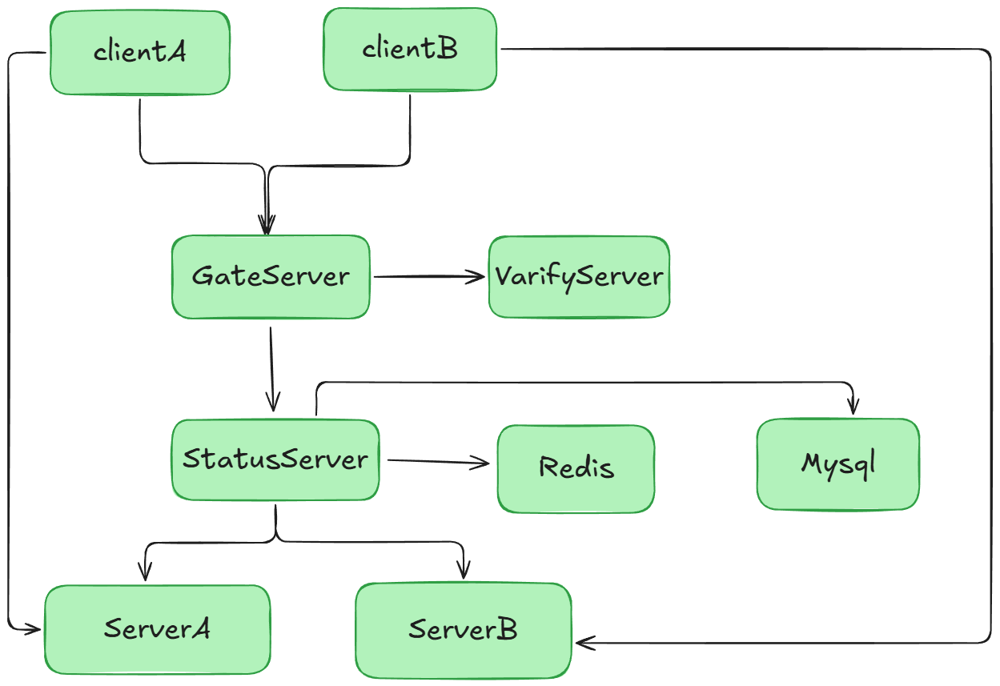

# C++全栈即时通讯项目

> 本项目为**C++全栈聊天项目实战**，包括PC端QT界面编程，asio异步服务器设计，boost网络库搭建http网关，node.js搭建验证服务，各服务间用grpc通信，server和client用asio通信等，也包括用户信息的录入等。实现跨平台设计，先设计windows的server，之后再考虑移植到windows中。较为全面的展示C++ 在实际项目中的应用，可作为项目实践学习案例，也可写在简历中。

## 技术栈

C++、boost::asio、protobuf、MySQL

## 架构设计

- GateServer为网关服务，主要应对客户端的连接和注册请求，因为服务器是是分布式，所以GateServer收到用户连接请求后会查询状态服务选择一个负载较小的Server地址给客户端，客户端拿着这个地址直接和Server通信建立长连接。

- 当用户注册时会发送给GateServer, GateServer调用VarifyServer验证注册的合理性并发送验证码给客户端，客户端拿着这个验证码去GateServer注册即可。

- StatusServer， ServerA， ServerB都可以直接访问Redis和Mysql服务。
