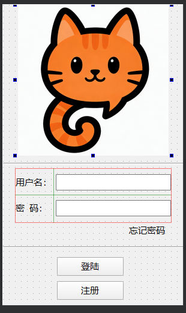
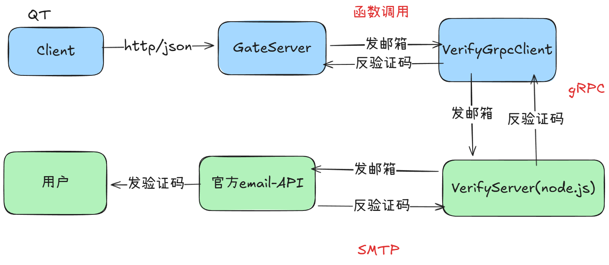
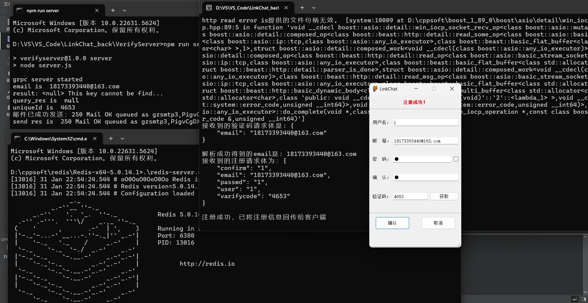

# LinkChat开发文档

> 一个仿微信的即时通讯项目


## 初始界面设计

### 如何添加图片资源

1. **在项目根目录下添加 `resources` 文件夹和其内内容**

```text
Link_Chat/
├─ CMakeLists.txt
├─ ...
└─ resources/
   ├─ images.qrc
   └─ images/
      ├─ logo.png
      └─ ...

```


2. **创建 Qt 资源文件（.qrc）**

```xml
<RCC>
    <qresource prefix="/">
        <file>images/logo.png</file>
    </qresource>
</RCC>
```


3. **CMakeLists.txt 中添加资源文件**

```cmake
set(PROJECT_SOURCES
        main.cpp
        mainwindow.cpp
        mainwindow.h
        mainwindow.ui
        resources/images.qrc #此处添加.qrc路径！！！
)
```


4. **在代码 / UI 中使用图片资源**

1️⃣ 设置窗口图标（最常见）

```cpp
this->setWindowIcon(QIcon(":/images/app.png"));
```

或在 `main.cpp`：

```cpp
QApplication a(argc, argv);
a.setWindowIcon(QIcon(":/images/app.png"));
```

------

2️⃣ QPushButton 设置图标

```cpp
ui->pushButton->setIcon(QIcon(":/images/start.png"));
ui->pushButton->setIconSize(QSize(32, 32));
```

------

3️⃣ QLabel 显示图片

```cpp
QPixmap pix(":/images/stop.png");
ui->label->setPixmap(pix);
ui->label->setScaledContents(true);
```


### 登陆界面设计

1. **点击左上角文件选择添加新文件**
2. **添加Qt 设计师界面类**
3. 界面设计如下：




### 注册界面设计

> 方法同上，设计如下：


创建好界面后接下来在LoginDialog.h类声明里添加信号

```cpp
signals:
    void switchRegister();
```


在LoginDialog.cpp 的构造函数里连接按钮点击事件

```cpp
connect(ui->reg_btn, &QPushButton::clicked, this, &LoginDialog::switchRegister);
```


按钮点击后LoginDialog发出switchRegister信号，该信号发送给MainWindow用来切换界面。

我们在MainWindow.h 里声明注册类变量

```cpp
private:
    RegisterDialog* _reg_dlg;
```

在其构造函数中添加注册类对象的初始化以及连接switchRegister信号

```cpp
    //创建和注册消息的链接
    connect(_login_dlg, &LoginDialog::switchRegister,
            this, &MainWindow::SlotSwitchReg);

    _reg_dlg = new RegisterDialog();
```


接下来实现槽函数SlotSwitchReg

```cpp
void MainWindow::SlotSwitchReg()
{
    setCentralWidget(_reg_dlg);
    _login_dlg->hide();
    _reg_dlg->show();
}
```

这样启动程序主界面优先显示登录界面，点击注册后跳转到注册界面


### 完善注册界面设计

1. 完善密码显示模式，勾选框实现是否可见

```cpp
RegisterDialog::RegisterDialog(QWidget *parent) : QDialog(parent), ui(new Ui::RegisterDialog)
{
    ui->setupUi(this);

    ui->passworld_lineEdit->setEchoMode(QLineEdit::Password);
    ui->confirmpassworld_lineEdit->setEchoMode(QLineEdit::Password);

    connect(ui->checkBox, &QCheckBox::toggled, this,
            [=](bool checked)
            {
                ui->passworld_lineEdit->setEchoMode(checked ? QLineEdit::Normal : QLineEdit::Password);
                ui->confirmpassworld_lineEdit->setEchoMode(checked ? QLineEdit::Normal : QLineEdit::Password);
            });
}
```


2. 正则表达式判断验证码是否合法，并附带文字提示效果

```cpp
// 更改提示文字和颜色的函数
void RegisterDialog::showMessage(const QString &msg, const QString &color)
{
    ui->error_tips->setStyleSheet("color: " + color + "; font-weight: bold;");
    ui->error_tips->setText(msg);
}
```

---

```cpp
// 槽函数 验证邮箱是否正确，正确就发验证码
void RegisterDialog::on_getvarify_pushButton_clicked()
{
    QString email = ui->email_lineEdit->text();

    QRegularExpression regex(R"((\w+)(\.|_)?(\w*)@(\w+)(\.(\w+))+)"); // 邮箱地址的正则表达式
    bool               match = regex.match(email).hasMatch();         // 执行正则表达式匹配

    if (match)
    {
        // 邮箱地址正确
        showMessage("发送成功！", "green");
        // 发送http请求获取验证码
    }
    else
    {
        // 提示邮箱不正确
        showMessage("邮箱地址错误！", "red");
    }
}
```


## 客户端单例类模板和http管理类

### 单例类模板

> 网络请求类要做成一个单例类，这样方便在任何需要发送http请求的时候调用，我们先实现单例类,添加singleton.h实现如下

```cpp
// 单例模板，方便别的类继承，基于 CRTP（模板继承）的“共享式单例模板”
#ifndef SINGLETON_H
#define SINGLETON_H

#include "global.h"

template <typename T>
class Singleton
{
protected:
    // 构造函数受保护
    // 防止外部直接 new Singleton<T>
    // 保证了只能由派生类或本模板内部构造
    Singleton() = default;

    // 虚析构函数
    // 确保通过基类指针销毁派生类对象时行为正确
    virtual ~Singleton() = default;

public:
    // 删除拷贝构造函数
    // 防止通过拷贝制造多个实例
    Singleton(const Singleton &) = delete;

    // 删除拷贝赋值运算符
    // 防止赋值语义破坏单例约束
    Singleton &operator=(const Singleton &) = delete;

    // 获取单例实例（共享指针形式）
    static std::shared_ptr<T> GetInstance()
    {
        // C++11 保证：
        // 1. static 局部变量只初始化一次
        // 2. 初始化过程线程安全
        // 3. 延迟到首次调用时创建对象
        static std::shared_ptr<T> instance{ new T };

        // 返回 shared_ptr 的副本
        // 引用计数 +1
        return instance;
    }
};

#endif // SINGLETON_H

```


### http管理类

> http管理类主要用来管理http发送接收等请求等

#### cmake添加网络库

> qt的http库函数需要先添加网络库，主要添加如下两块地方：

```cmake
find_package(QT NAMES Qt6 Qt5 REQUIRED COMPONENTS Widgets Network) #添加Network网络模块
find_package(Qt${QT_VERSION_MAJOR} REQUIRED COMPONENTS Widgets Network) #添加Network网络模块
```

---

```cmake
target_link_libraries(Link_Chat PRIVATE
    Qt${QT_VERSION_MAJOR}::Widgets
    Qt${QT_VERSION_MAJOR}::Network #链接网络模块
)
```


#### 发送请求实现逻辑

> 现在这个逻辑暂时实现了客户端向服务器发送验证码请求并处理回文的逻辑，但是扩展性是百分百的，后续其他功能在现有函数上续写就行：


#### 奇异递归（CRTP）

​	**一种技术手段，可以实现：**

- 编译期类型绑定

- 零运行时开销的多态

- 基类能安全地操作派生类类型

> **常用奇异递归来实现单例模板类。**

 

如http管理类

```cpp
class httpmgr : public QObject, public Singleton<httpmgr>, public std::enable_shared_from_this<httpmgr>
{
    Q_OBJECT
public:
    ~httpmgr(); // 基类模板在析构时要析构静态成员，静态成员的析构由智能指针管理，智能指针的析构类型是T，T就是派生类的类型，因此派生类的析构要是public

private:
    friend class Singleton<httpmgr>; // 基类声明为派生类的友元函数，使基类可以访问子类构造函数
    httpmgr();

    QNetworkAccessManager _manager;

    void postHttpreq(QUrl url, QJsonObject json, ReqId req_id, Module mod); // 发送post请求，参数是路由，json，请求id，注册模块

private slots:
    void Slots_sig_http_finish(ReqId id, QString res, ErrorCode err, Module mod); // 处理接收到：发送成功，接收成功/失败两种信号的槽函数

signals:
    void sig_http_finish(ReqId id, QString res, ErrorCode err, Module mod); // 发送http给服务器，返回：发送成功，接收成功/失败两种信号
    void sig_reg_mod_finish(ReqId id, QString res, ErrorCode err);          // 注册模块是否结束的信号
};
```


### 枚举类型

> 为了代码规范和解耦、日后维护，很多状态类型采用了枚举类型定义在 `global.h` 中：

```cpp
// 请求 ID：用于客户端与服务端通信协议
enum class ReqId : int
{
    GetVerifyCode = 1001, // 获取验证码
    RegisterUser = 1002,  // 注册用户
};

// 模块 ID：用于区分业务模块
enum class Module : int
{
    Register = 0, // 注册模块
};

// 错误码：统一的返回状态
enum class ErrorCode : int
{
    Success = 0,    // 成功
    JsonError = 1,  // JSON 解析错误
    NetworkErr = 2, // 网络错误
};
```


### 注册消息处理

> 本节暂时实现了**注册模块的验证码的发送接受逻辑** ：

1. 需要对RegisterDialog注册消息处理，头文件声明

```cpp
QMap<ReqId, std::function<void(const QJsonObject&)>> _handlers;
```


2. 在RegisterDialog中添加注册消息处理的声明和定义。根据ReqId的业务不同，继续添加注册函数就行，扩展性很好：

```cpp
void RegisterDialog::initHttpHandlers()
{
    //注册获取验证码回包逻辑
    _handlers.insert(ReqId::ID_GET_VARIFY_CODE, [this](QJsonObject jsonObj){
        int error = jsonObj["error"].toInt();
        if(error != ErrorCodes::SUCCESS){
            return;
        }
        auto email = jsonObj["email"].toString();
        showTip(tr("验证码已发送到邮箱，注意查收"), true);
        qDebug()<< "email is " << email ;
    });
    
    // 后续扩展
}
```


3. 回到 `slot_reg_mod_finish` 函数添加根据id调用函数处理对应逻辑

```cpp
void RegisterDialog::slot_reg_mod_finish(ReqId id, QString res, ErrorCodes err)
{
   //前面逻辑省略...
    //调用对应的逻辑,根据id回调。
    _handlers[id](jsonDoc.object());

    return;
}
```


## 网关服务器设计

> 设计一个网关服务器类，应答客户端的基本连接请求。


### boost库安装

详见 C++ 网络编程详细安装教程


### jsoncpp安装

> 和 `protobuf` 一样的序列化工具，数据比较直观人类可见

jsoncpp下载地址：
https://github.com/open-source-parsers/jsoncpp
官方文档：
http://jsoncpp.sourceforge.net/old.html

选择windows版本的下载。

如果下载速度很慢，可以去我的网盘地址下载
https://pan.baidu.com/s/1Yg9Usdc3T-CYhyr9GiePCw?pwd=ng6x

验证码ng6x


[详细流程见](https://www.yuque.com/lianlianfengchen-cvvh2/dz8xhn/om2vxifqett5r54b)


### boost::beast实现http网关服务器

**beast = asio + http/websocket**

- beast 在 asio 基础上封装了http的协议层，避免了asio反复造轮子。


**在网关服务器实现了基本的get和post请求的处理逻辑，逻辑如下：**


## gRPC

### 简介

gRPC是Google开发的一种高性能、开源的远程过程调用（RPC）框架。它可以让客户端应用程序像调用本地服务一样轻松地调用远程服务，并提供了多种语言的支持，如C++、Java、Python、Go等。

gRPC使用Protocol Buffers作为数据格式，可以在不同的平台上进行应用程序之间的通信，支持多种编程语言和多种操作系统。它采用基于HTTP/2的协议，提供了高效、快速且可扩展的远程调用功能，并带有负载均衡、认证、监控等功能，方便用户管理和维护分布式系统。

gRPC可用于构建各种类型的分布式应用程序，如微服务、云原生应用程序、大规模Web应用程序、移动应用程序等场景。由于其高性能和可扩展性，越来越多的企业和组织开始采用gRPC来构建他们的应用程序和服务。


### windows下载grpc环境

[grpc下载](https://github.com/grpc/grpc)

[cmake下载](https://cmake.org/download/)

[NASM下载](https://www.nasm.us/) ，这个要配一下环境变量

[go环境](https://studygolang.com/dl)

[Perl](https://www.activestate.com/products/perl/)

[**详细流程**](https://www.yuque.com/lianlianfengchen-cvvh2/dz8xhn/gfyq4fo8yiwfa1qi)


### visualstudio配置grpc

[**详细流程**](https://www.yuque.com/lianlianfengchen-cvvh2/dz8xhn/gaw542ceszmhuuuv)

还是推荐使用vspck


### 在获取验证中使用grpc

1. 新增加一个类：`VerifyGrpcClient`，和GateServer类平级，**作为中转站使用：**

   - 接受 LogicSystem 里的post请求里发来的 **email**
   - 然后把 **email** 发给 `VerifyServer（node.js）`  
   - `VerifyServer` 使用 `email` 调用官方的 api 接口

   - 流程图如下，注意只有 **`VerifyGrpcClient` < - > VerifyServer** 使用了 grpc：

   

   2. 新增 **`VerifyServer`** ，使用 node.js 编写，专门用于调用邮箱官方 api，返回验证码

   进入cmd 执行如下命令启动：

   ```js
   npm run server
   ```


## 客户端请求验证码

### post邮箱逻辑

之前在httpmgr实现了post逻辑，现在在RegisterDialog类实现post邮箱以获取的逻辑

```cpp
// 槽函数 验证邮箱是否正确，正确就发验证码
void RegisterDialog::on_getvarify_pushButton_clicked()
{
    QString email = ui->email_lineEdit->text();

    QRegularExpression regex(R"((\w+)(\.|_)?(\w*)@(\w+)(\.(\w+))+)"); // 邮箱地址的正则表达式
    bool match = regex.match(email).hasMatch();                       // 执行正则表达式匹配

    if (match)
    {
        // 邮箱地址正确
        showMessage("发送成功！", "green");

        // 发送http请求获取验证码
        QJsonObject json_obj;
        json_obj["email"] = email;
        httpmgr::GetInstance()->postHttpreq(QUrl(gate_url_prefix + "/get_verifycode"), json_obj, ReqId::GetVerifyCode, Module::Register);
        qDebug() << "Final Post URL:" << QUrl(gate_url_prefix + "/get_verifycode").toString();
    }
    else
    {
        // 提示邮箱不正确
        showMessage("邮箱地址错误！", "red");
    }
}
```


### 客户端配置管理

客户端好多数据如url都是写死的，为了方便后期维护，代码解耦，增加配置文件 `config.ini`

```ini
[GateServer]
host=localhost
port=8080
```


程序最终会输出的bin目录，所以在 `cmake` 最后一行中添加逻辑拷贝脚本将配置文件也拷贝到bin目录，使得其平台无关

```cmake
# config文件的相关配置，便于只在config改ip和端口就可以改访问端点，代码解耦
if(WIN32 AND CMAKE_BUILD_TYPE STREQUAL "Debug")

    add_custom_command(
        TARGET LinkChat_front
        POST_BUILD
        COMMAND ${CMAKE_COMMAND} -E copy_if_different
                "${CMAKE_SOURCE_DIR}/config.ini"
                "$<TARGET_FILE_DIR:LinkChat_front>"
    )
endif()
```


global.h中添加声明

```cpp
extern QString gate_url_prefix;
```

在cpp中添加定义

```cpp
QString gate_url_prefix = "";
```

在main函数中添加解析配置的逻辑

```cpp
    QString fileName = "config.ini";                           // 生成 config.ini 的绝对路径（平台无关）
    QString app_path = QCoreApplication::applicationDirPath(); // 获取程序运行路径
    QString config_path = QDir::toNativeSeparators(app_path + QDir::separator() + fileName);
    QSettings settings(config_path, QSettings::IniFormat); // 以 INI 格式加载配置文件
    QString gate_host = settings.value("GateServer/host").toString();
    QString gate_port = settings.value("GateServer/port").toString(); // 读取网关服务器的配置项，即config文件里面的内容，只用在config里面改ip和端口就行，随时换
    gate_url_prefix = "http://" + gate_host + ":" + gate_port; // 拼装网关访问前缀
```


将RegisterDialog发送post请求修改为

```cpp
 HttpMgr::GetInstance()->PostHttpReq(QUrl(gate_url_prefix+"/get_varifycode"),
                     json_obj, ReqId::ID_GET_VARIFY_CODE,Modules::REGISTERMOD);
```


### C-S 完整获取验证码流程

分别启动 GateServer、VerifyServer、Qt，可以看到都打通了，而且手机可以收到验证码。


##  io_context线程池

> 连接池和线程池有本质区别

```bash
[AsioIOServicePool]  ← I/O 线程池（事件循环）
        ↓
   异步 socket
        ↓
[Redis / gRPC / MySQL]
        ↓
   各自的连接池
```


### 缺陷与解决思路

缺陷：现在的 `socket` 都是绑定在一个 `io_context` 的，**所有的异步操作由一个主线程的 ioc 调度**

解决：**写一个线程池**，每个线程搭配一个 io_context


### ioc线程池写法

> 注意这种程池写法，虽然连接池和线程池有区别，但是后续连接池的写法和这个线程池写法有相似之处

1. **单例模式：** 这些线程池都是单例模式，保证全局唯一线程池

2. **线程池的初始化在构造函数：** 保证在调用单例接口时初始化线程池，且只会初始化一次

   > 一般线程池的构造函数都是无参构造或显式构造，保证只会初始化一次且语意清晰，此处使用的是默认参数构造

```cpp
/*
AsioiocontextPool 是一个“io_context 线程池 + 负载分发器 + 生命周期管理器”的单例组件。
多个线程，每个线程有一个ioc
*/
#include <vector>
#include <boost/asio.hpp>
#include "Singleton.h"

class AsioiocontextPool :public Singleton<AsioiocontextPool>//奇异递归，保证单例类,全局只有一个线程池
{
    friend Singleton<AsioiocontextPool>;//构造函数是私有的，只有单例模板可以调用他，防止外部new
public:
    using io_context = boost::asio::io_context;
    //io_context没有任务会立即退出，work防止 io_context.run() 在“暂时没任务”时退出
    using Work = boost::asio::executor_work_guard<io_context::executor_type>;
    using WorkPtr = std::unique_ptr<Work>;

    ~AsioiocontextPool();
    
    boost::asio::io_context& Getioc();//继续得到上下文
    void Stop();//停止服务池

private:
    AsioiocontextPool(std::size_t size = 2/*std::thread::hardware_concurrency()*/);//构造函数，线程多少
    std::vector<io_context> _ioc;//存上下文的容器
    std::vector<WorkPtr> _works;//每个ioc有一个work
    std::vector<std::thread> _threads;//线程集合
    std::size_t _nextioc;//实现轮询分配，一个请求一个ioc 
};
```

```cpp
#include "AsioiocontextPool.h"
#include <iostream>
using namespace std;

//在初始化池的大小的时候就初始化了io_context和Work的数目,有默认参数，两个
AsioiocontextPool::AsioiocontextPool(std::size_t size) :_ioc(size),_works(size), _nextioc(0) 
{
    for (std::size_t i = 0; i < size; ++i) 
    {
        //保证work和ioc生命周期绑定，保证等会run()的时候，没有任务ioc也不会直接返回
        _works[i] = std::unique_ptr<Work>(new Work(_ioc[i].get_executor()));
    }

    //遍历多个ioservice，创建多个线程，每个线程内部启动ioservice
    for (std::size_t i = 0; i < _ioc.size(); ++i) 
    {
        _threads.emplace_back([this, i]() {
            _ioc[i].run();
            });
    }
}

AsioiocontextPool::~AsioiocontextPool() 
{
    Stop();//先清空池子，再析构
    std::cout << "AsioIOServicePool destruct" << endl;
}

boost::asio::io_context& AsioiocontextPool::Getioc() 
{
    auto& service = _ioc[_nextioc++];
    if (_nextioc == _ioc.size())
    {
        _nextioc= 0;
    }
    return service;
}

void AsioiocontextPool::Stop()
{
    _works.clear();//先把work和ioc的绑定解除

    for (auto& ioc : _ioc)//手动stop每个ioc
    {
        ioc.stop();
    }

    for (auto& t : _threads)//等待所有线程安全结束
    {
        if (t.joinable())
            t.join();
    }
}
```


### 修改获取ioc入口

修改CServer处Start逻辑, 改为每次从IOServicePool连接池中获取连接

```cpp
void CServer::Start()
{
	auto self = shared_from_this();//捕获self，延长CServer对象的声明周期， 直到异步回调结束

	//从连接池拿一个ioc，在此处构造AsioiocontextPool类，构造函数创建ioc池子。由于GetInstance是static线程安全，全局只会构造一次
	auto& io_context = AsioiocontextPool::GetInstance()->Getioc();

	//io_context作为参数初始化了httpConnection，且用 new_con 是一个指向 httpConnection 对象的智能指针对象
	std::shared_ptr<httpConnection> new_con = std::make_shared<httpConnection>(io_context);

	_acceptor.async_accept(new_con->GetSocket(), [self,new_con](beast::error_code ec) //异步回调，当有客户端连接到该端口时，把连接结果放入 _socket，然后调用回调
		{
			try 
			{
				if (ec)//出错了就放弃本次socket连接,继续监听下一个连接
				{
					self->Start();
					return;
				}

				//没错就创建新连接，并开启htppConnection类开始管理这个连接
				new_con->Start();//是httpconnection的start
				self->Start();
			}
			catch (std::exception& exp)
			{
				std::cout << "exception is " << exp.what() << std::endl;
				self->Start();
			}
		});
}
```


## gRPC连接池

> `grpc` 发生在VS的 `VerifyGrpcClient` 类与 nodejs的 `verifyserver` 的验证码通讯过程中，添加grpc连接池保证高并发

### 一种连接池写法

此处是一种连接池写法，用到了两个类：

1. **RPCconPool类：** 连接池本身，正常的连接池类写法，不是单例模式，且有参
2. **VerifyGrpcClient类：** 连接池的管理类，**其是单例模式且在无参构造函数中初始化连接池**

```cpp
/*
GateServer网关类只要验证码结果，本类就是专门处理验证码的中转站：

GateServer网关类，向本类VerifyGrpcClient发送邮箱以获取验证码
即LogicSystem里的post请求在解析到qt客户端发来的email后，将那个email给到本类，本类再发给nodejs调用官方的api接口

官方api接口会：
1. 发送验证码到具体设备
2. 同时把验证码回传给本类，本类再给到网关类

只有 VerifyGrpcClient <-> VerifyServer(nodejs文件) 这一段使用了 gRPC + Protobuf 通信
*/

/*
这个类其实也是一个rpcpool连接池管理类，在这个类的构造函数里面初始化连接池，每次只调用一个连接，用完还回去
*/

#pragma once

#include <grpcpp/grpcpp.h>
#include "message.grpc.pb.h"
#include "const.h"
#include "Singleton.h"
using grpc::Channel;
using grpc::Status;
using grpc::ClientContext;

using message::GetVarifyReq;
using message::GetVarifyRsp;
using message::VarifyService;

//rpc连接池
class RPCconPool
{
public:
    RPCconPool(size_t poolsize, std::string host, std::string port);

    //析构函数，在对象消亡前，确保没有线程再使用内部资源
    ~RPCconPool() 
    {
        std::lock_guard<std::mutex> lock(mutex_);//析构线程必须等当前持锁的操作完成
        Close();//先广播，再清理。保证wait线程唤醒并安全退出
        while (!_connections.empty())
        {
            _connections.pop();//清空连接池
        }
    }

    void Close();

    std::unique_ptr<VarifyService::Stub> getConnection();

    void returnConnection(std::unique_ptr<VarifyService::Stub> context);

private:
    std::atomic<bool> b_stop_;
    size_t _poolsize;
    std::string _host;
    std::string _port;
    std::queue<std::unique_ptr<VarifyService::Stub>> _connections;//唯一持有stub，Stub 就是“本地对象和远程服务”的桥梁
    std::condition_variable cond_;//C++11 引入的线程同步原语，防止线程忙等空转消耗cpu，让线程直接休眠，条件满足再唤醒，不消耗cpu
    std::mutex mutex_;//互斥，控制队列线程安全
};

class VerifyGrpcClient :public Singleton<VerifyGrpcClient>//单例，全局只需要一个gRPC客户端
{
    friend class Singleton<VerifyGrpcClient>;//强制单例模式

public:
    GetVarifyRsp GetVarifyCode(std::string email);

private:
    VerifyGrpcClient();
    std::unique_ptr<RPCconPool> _pool;
};
```

---

3. `VerifyGrpcClient` 类构造函数初始化连接池：

```cpp
VerifyGrpcClient::VerifyGrpcClient()//构造函数初始化
{ 
    auto& cfgMgr = ConfigMgr::instance();
    const SectionInfo& sec = cfgMgr.getSection("VerifyServer");

    std::string host = sec.get("Host");
    std::string port = sec.get("Port");

    _pool.reset(new RPCconPool(5, host, port));//初始化连接池，在VerifyGrpcClient类调用单例方法时自动构造，初始化连接池
}
```

---

4. `RPCconPool` 池子类构造函数，上面的构造函数初始化时调用这个构造函数真正填满池子

```cpp
//线程池
RPCconPool::RPCconPool(size_t poolsize, std::string host, std::string port)
    :_poolsize(poolsize), _host(host), _port(port) ,b_stop_(false)//连接池一开始是“可用状态”,所有等待线程默认可以正常工作
{
    for (size_t i = 0; i < _poolsize; i++)
    {
        //指定验证码服务地址，gRPC通信方式
        //每个线程一个信使
        std::shared_ptr<Channel> channel = grpc::CreateChannel(host+":"+port, grpc::InsecureChannelCredentials());
        _connections.push(VarifyService::NewStub(channel));
    }
}
```


### 使用场景

1. 这是获取验证码的函数，每次使用实例化的 `_pool` 从连接池获取一个连接，且处理完事物就归还

```cpp
//跨进程调用获取验证码的服务，grpc。在logicsystem中被使用到
GetVarifyRsp VerifyGrpcClient::GetVarifyCode(std::string email)
{
    ClientContext context;//一次grpc的上下文
    GetVarifyRsp reply;//nodejs返回的验证码,这里是grpc
    GetVarifyReq request;//发送给nodejs
    request.set_email(email);

    //注意这个GetVarifyCode和函数名不是一个东西，这个GetVarifyCode是导入的包里面的东西，专门用来跨进程调用的
    Status status = _pool->getConnection()->GetVarifyCode(&context, request, &reply);//真正的跨进程调用nodejs，这里用到了grpc

    if (status.ok())
    {
        _pool->returnConnection(std::move(_pool->getConnection()));
        return reply;
    }
    else
    {
        reply.set_error(ErrorCodes::RPCFailed);
        return reply;
    }
}
```

> 若对此处 `_pool->getConnection()->GetVarifyCode(&context, request, &reply);` 的调用关系有疑惑：
>
> 1. `_pool->getConnection()` 是因为 `_pool` 本身是 `RPCconPool` 类型自然可以调用其方法，其返回的是一个 `Stub` 对象
> 2. 而 `Stub` 对象天生包含 `GetVarifyCode(&context, request, &reply)` 这个方法。`Stub` 对象和 `GetVarifyCode(&context, request, &reply)` 方法都是gRPC + Protobuf 第三方库 **自动生成的客户端类**


2. 在 `LogicSystem` 类中的处理 `"/get_verifycode"` 的post请求处真正使用到了这个连接池

```cpp
//同步调用 gRPC 服务获取验证码。此时就创建了VerifyGrpcClient这个单例，自动初始化了rpc连接池且只初始化一次
GetVarifyRsp grpc_rsp = VerifyGrpcClient::GetInstance()->GetVarifyCode(email);
```

此处：

- `VerifyGrpcClient::GetInstance()` ：是懒加载单例，此处正式初始化`VerifyGrpcClient`类，并在其构造函数中初始化连接池且全局只初始化一次，因为单例是 `static` 

- 此时就会调用上述的 `GetVarifyCode(std::string email)` 函数，**单例保证全局初始化一次，连接池保证了gRPC的高并发性**


## 搭建redis服务

### 安装redis服务器

> 下载 `redis` 后运行，这个运行的 `redis` 本质就是个redis服务器


1. windows下载redis：[https://github.com/tporadowski/redis/releases](https://github.com/tporadowski/redis/releases)

​	可以在redis.windows.conf, 修改端口和加密码：

```bash
port 6380
```

​	找到requirepass foobared，下面添加requirepass

```
# requirepass foobared
requirepass 123456
```


2. 启动redis服务器，在redis安装目录执行如下命令。**后续所有需要使用到 `redis` 数据库的地方都要先启动这个 `redis` 服务器。**

```
.\redis-server.exe .\redis.windows.conf
```


3. 启动客户端，需要先启动服务器，输入密码登录成功。**这个命令是用来查看redis服务器有没有启动连接成功的**

```bash
.\redis-cli.exe -p 6380
```


### C++搭建redis服务

> **上面安装的是redis服务器，这里安装第三方库C++写入代码后就相当于客户端了。**

> C++的redis第三方库很多，常用hiredis（偏C风格）和redis-plus-plus（基于hiredis且更适配C++）。
>
> **使用vcpkg来配环境，更加方便！**


1. 安装vcpkg

```bash
https://github.com/microsoft/vcpkg/releases
```


2. 在vcpkg目录下安装redis-plus-plus（会自动安装hiredis依赖）

```
vcpkg install redis-plus-plus:x64-windows
```


3. **集成到 Visual Studio**

```bash
vcpkg integrate install
```


4. 验证安装

```bash
vcpkg list | findstr redis
```


5. 基本连接示例。**记得重启vs！，不然引入不了头文件**

```bash
#include <iostream>
#include <sw/redis++/redis++.h>

int main() {
    try {
        // 连接Redis服务器
        sw::redis::Redis redis("tcp://127.0.0.1:6379");
        
        // 如果有密码
        redis.auth("your_password");
        
        // 测试连接
        redis.ping();
        std::cout << "Redis连接成功！" << std::endl;
        
    } catch (const sw::redis::Error& e) {
        std::cerr << "Redis错误: " << e.what() << std::endl;
    }
    
    return 0;
}
```


### Nodejs搭建redis服务

> 不仅C++可以连 `redis` ，`verifyServer` 部分的nodejs 代码也可以连 `redis` ，保证验证码发送。且ip和端口一样的话就是使用的同一个 `redis` 数据库，保证了不用语言的协同运行。

1. `verifyServer` 目录下安装 `redis` 

   ```bash
   npm install ioredis
   ```

2. 后续在 `verifyserver` 文件中加上 `nodejs` 代码逻辑就行，这里不对 `nodejs` 代码进行赘述

   > `nodejs` 的验证码逻辑是：请求了就生成四位二维码，发一份给用户存一份在 `redis` 且**一分钟后自动删除**。若一分钟内多次请求就先看 `redis` 里面邮箱有没有这对应个验证码，有就不生成新的，但是会再给用户发一个相同验证码。

 

### redis连接池

#### 另一种连接池写法

`redis` 连接池的写法只使用一个类，**池子的初始化仍然在无参(全局配置、常量等)构造函数中，保证能任意处初始化且只初始化一次：**

1. **头文件类声明：** 单例类，无参构造函数。

   > **切记：析构函数一定不能是 `private` ，因为 `RedisPool` 析构函数里包含线程唤醒和连接释放逻辑；如果析构是 private，运行时无法调用它，最终导致阻塞线程、资源泄漏甚至程序退出崩溃。**

```cpp
#pragma once

#include "Singleton.h"
#include "ConfigMgr.h"
#include <sw/redis++/redis++.h>
#include "const.h"

class RedisPool : public Singleton<RedisPool>
{
    friend class Singleton<RedisPool>;

public:
    // 获取连接
    std::shared_ptr<sw::redis::Redis> getConnection();

    // 归还连接
    void returnConnection(std::shared_ptr<sw::redis::Redis> conn);

    // 关闭池子（一般只在程序退出时）
    void Close();

    // 构造函数：构造即初始化池子
    RedisPool();
    ~RedisPool();

private:
    std::atomic<bool> b_stop_{ false };
    size_t poolSize_{ 0 };

    std::queue<std::shared_ptr<sw::redis::Redis>> connections_;
    std::mutex mutex_;
    std::condition_variable cond_;
};
```

---

2. **构造函数：** 在构造函数里面就地初始化填满池子

```cpp
RedisPool::RedisPool()
{
    // 1. 从配置中心读取 Redis 配置
    auto& cfgMgr = ConfigMgr::instance();
    const auto& sec = cfgMgr.getSection("Redis");

    std::string host = sec.get("Host");
    int port = std::stoi(sec.get("Port"));
    std::string pwd = sec.get("PassWord");
    poolSize_ = 5;

    // 2. redis++ 连接配置
    sw::redis::ConnectionOptions opts;
    opts.host = host;
    opts.port = port;
    opts.password = pwd;
    opts.socket_timeout = std::chrono::milliseconds(2000);

    // 3. 初始化连接池
    for (size_t i = 0; i < poolSize_; ++i)
    {
        try {
            auto redis = std::make_shared<sw::redis::Redis>(opts);
            connections_.push(redis);
        }
        catch (const sw::redis::Error& e) {
            std::cerr << "[RedisPool] 连接失败: " << e.what() << std::endl;
        }
    }

    if (connections_.empty()) 
    {
        std::cerr << "[RedisPool] 警告：没有成功创建任何 Redis 连接" << std::endl;
    }
}
```


#### 使用场景

在 `LogicSystem` 类中的处理 `"/get_verifycode"` 的post请求处真正使用到了这个连接池


```cpp
	// 处理客户端 post 用户注册请求
	RegPost("/user_register", [](std::shared_ptr<httpConnection> connection)
		{
			auto body = boost::beast::buffers_to_string(connection->_request.body().data());
			std::cout << "接收到的注册请求体为：" << body << std::endl;

			connection->_response.set(http::field::content_type,"application/json; charset=utf-8");

			Json::Value resp;
			Json::Value req;
			Json::Reader reader;

			if (!reader.parse(body, req))
			{
				std::cout << "解析注册请求(json)失败"<<std::endl;
				resp["error"] = ErrorCodes::Error_Json;
				resp["message"] = "解析注册请求(json)失败";
				beast::ostream(connection->_response.body()) << resp.toStyledString();
				return true;
			}

			auto pool = RedisPool::GetInstance();

			// ================== 1. 校验验证码 ==================
			std::string varify_code;

			auto redis = pool->getConnection();
			if (!redis) 
			{
				std::cout << "redis连接失败" << std::endl;
				resp["error"] = ErrorCodes::RedisError;
				resp["message"] = "redis unavailable";
				beast::ostream(connection->_response.body()) << resp.toStyledString();
				return true;
			}

			try
			{
				auto val = redis->get("code_" + req["email"].asString());//nodejs代码往redis里面插入的验证码有“code_” 前缀
				if (!val)
				{
					std::cout << "验证码过期"<< std::endl;
					pool->returnConnection(redis);
					resp["error"] = ErrorCodes::VerifyExpired;
					resp["message"] = "验证码过期";
					beast::ostream(connection->_response.body()) << resp.toStyledString();
					return true;
				}

				varify_code = *val;
				pool->returnConnection(redis);
			}
			catch (const sw::redis::Error& e)
			{
				std::cout << "捕获到异常" << std::endl;
				pool->returnConnection(redis);
				resp["error"] = ErrorCodes::RedisError;
				resp["message"] = "redis error";
				beast::ostream(connection->_response.body()) << resp.toStyledString();
				return true;
			}

			if (varify_code != req["varifycode"].asString())
			{
				std::cout << "验证码错误" << std::endl;
				resp["error"] = ErrorCodes::VerifyCodeError;
				resp["message"] = "验证码错误";
				beast::ostream(connection->_response.body()) << resp.toStyledString();
				return true;
			}

			// ================== 3. 后续逻辑,返回给客户端 ==================
			resp["error"] = 0;
			resp["email"] = req["email"];
			resp["user"] = req["user"].asString();
			resp["passwd"] = req["passwd"].asString();
			resp["confirm"] = req["confirm"].asString();
			resp["varifycode"] = req["varifycode"].asString();

			beast::ostream(connection->_response.body()) << resp.toStyledString();
			std::cout << "注册成功，已将注册信息回传给客户端" << std::endl;
			return true;
		});
}
```


## 注册功能实现

> 在上诉 `redis` 服务搭建完成之后，在 `Qt` 客户端代码中添加如下内容：

1. 注册界面 **确认按钮** 的槽函数

```cpp
// 注册界面的个人注册的按钮，post注册请求
void RegisterDialog::on_confirm_pushButton_clicked()
{
    if (ui->usr_lineEdit->text() == "")
    {
        showMessage("用户名不能为空！", "red");
        return;
    }

    if (ui->email_lineEdit->text() == "")
    {
        showMessage("邮箱不能为空！", "red");
        return;
    }

    if (ui->password_lineEdit->text() == "")
    {
        showMessage("密码不能为空！", "red");
        return;
    }

    if (ui->confirmpassworld_lineEdit->text() != ui->password_lineEdit->text())
    {
        showMessage("密码冲突，请确认密码！", "red");
        return;
    }

    if (ui->verify_lineEdit->text() == "")
    {
        showMessage("验证码不能为空！", "red");
        return;
    }

    // json向网关服务器发送注册模块的申请
    QJsonObject json_obj;
    json_obj["user"] = ui->usr_lineEdit->text();
    json_obj["email"] = ui->email_lineEdit->text();
    json_obj["passwd"] = ui->password_lineEdit->text();
    json_obj["confirm"] = ui->confirmpassworld_lineEdit->text();
    json_obj["varifycode"] = ui->verify_lineEdit->text();
    httpmgr::GetInstance()->postHttpreq(QUrl(gate_url_prefix + "/user_register"), json_obj, ReqId::RegisterUser, Module::Register);
}
```

---

2. 注册事件的回包逻辑

```cpp
 // 处理用户注册的回包逻辑
    _handlers.insert(ReqId::RegisterUser, [this](QJsonObject jsonObj) {
        int error = jsonObj["error"].toInt();
        if (error != static_cast<int>(ErrorCode::Success)) // 强枚举类型，要显示转换
        {
            showMessage("参数错误！", "red");
            return;
        }

        showMessage("注册成功！", "red");
    });
```


此时分别启动：`Redis服务器`、 `GateServer`、`VerifyServer`、`qt客户端` 发现注册功能基本实现：



