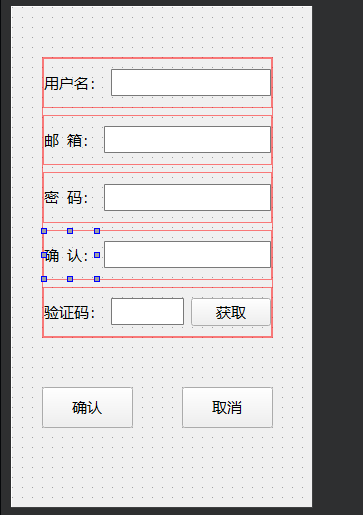
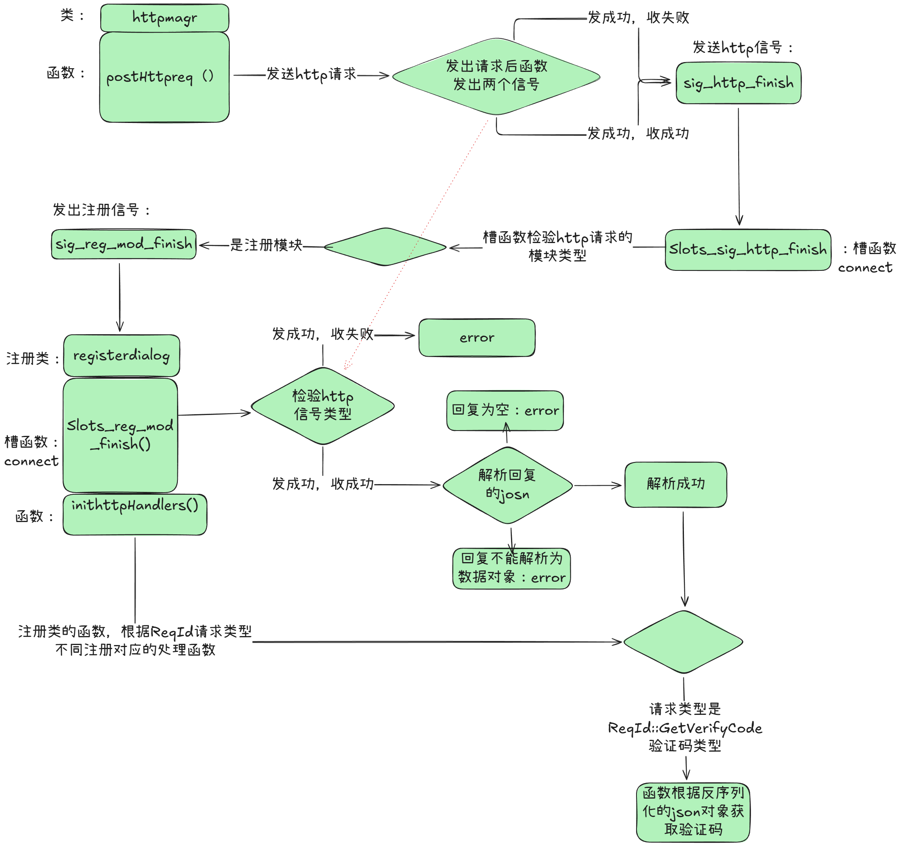
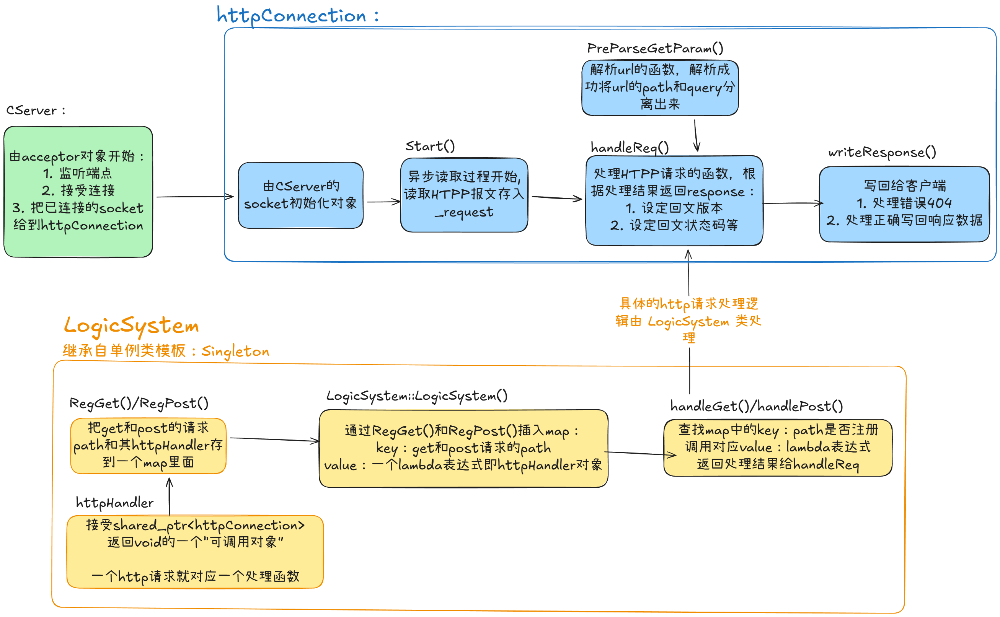
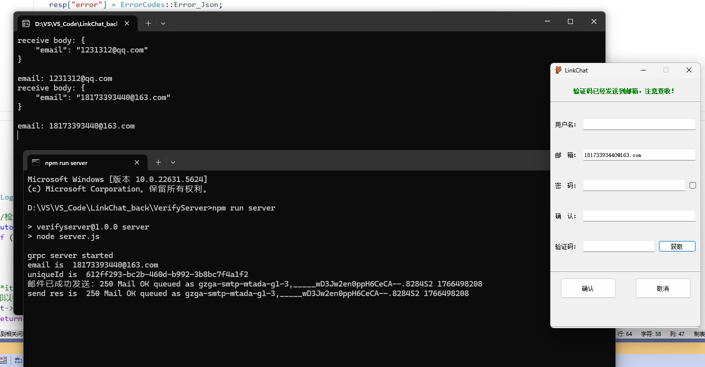
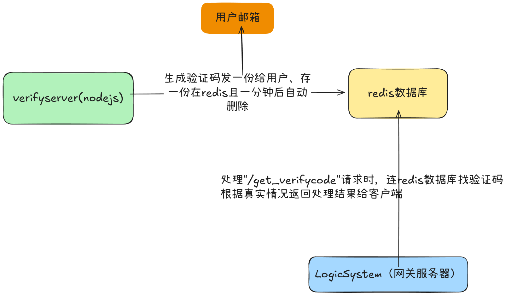
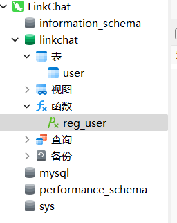
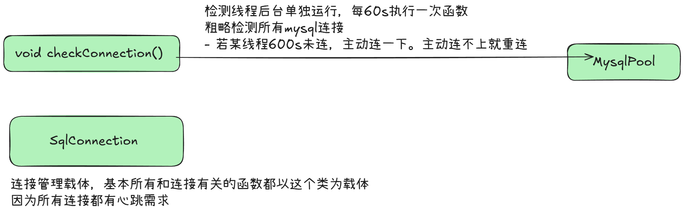
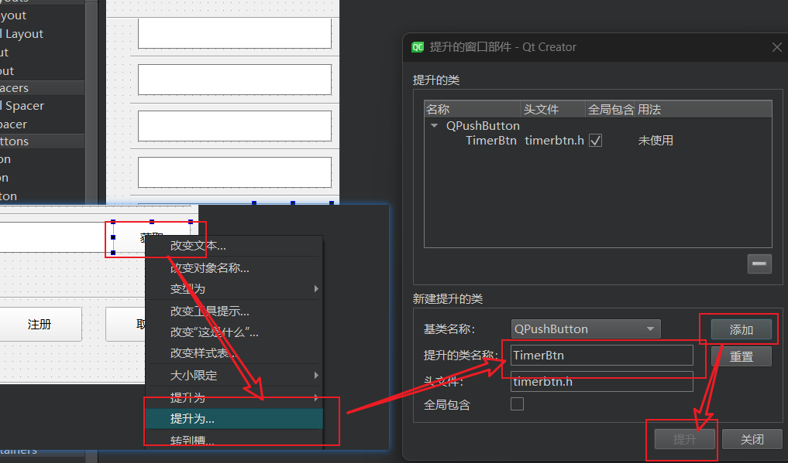
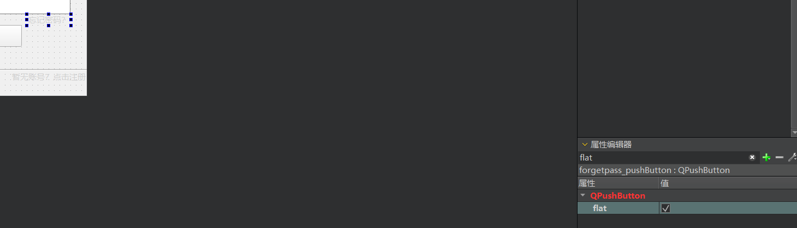
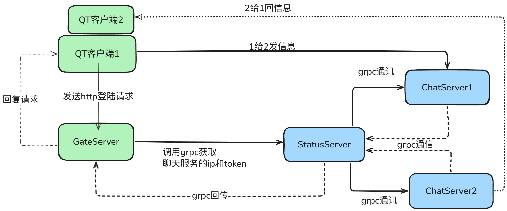

# LinkChat开发文档

> 一个仿微信的即时通讯项目


## 初始界面设计

### 如何添加图片资源

1. **在项目根目录下添加 `resources` 文件夹和其内内容**

```text
Link_Chat/
├─ CMakeLists.txt
├─ ...
└─ resources/
   ├─ resources.qrc
   └─ images/
      ├─ logo.png
      └─ ...
```


2. **创建 Qt 资源文件（.qrc）**，后续添加其他资源也要加进来

```xml
<RCC>
    <qresource prefix="/">
        <file>images/logo.png</file>
    </qresource>
</RCC>
```


3. **CMakeLists.txt 中添加资源文件**

```cmake
set(PROJECT_SOURCES
        main.cpp
        mainwindow.cpp
        mainwindow.h
        mainwindow.ui
        resources/resources.qrc #此处添加.qrc路径！！！
)
```


4. **在代码 / UI 中使用图片资源**

1️⃣ 设置窗口图标（最常见）

```cpp
this->setWindowIcon(QIcon(":/images/app.png"));
```

或在 `main.cpp`：

```cpp
QApplication a(argc, argv);
a.setWindowIcon(QIcon(":/images/app.png"));
```

------

2️⃣ QPushButton 设置图标

```cpp
ui->pushButton->setIcon(QIcon(":/images/start.png"));
ui->pushButton->setIconSize(QSize(32, 32));
```

------

3️⃣ QLabel 显示图片

```cpp
QPixmap pix(":/images/stop.png");
ui->label->setPixmap(pix);
ui->label->setScaledContents(true);
```


### 登陆界面设计

1. **点击左上角文件选择添加新文件**
2. **添加Qt 设计师界面类**
3. 界面设计如下：


### 注册界面设计

> 方法同上，设计如下：



创建好界面后接下来在LoginDialog.h类声明里添加信号

```cpp
signals:
    void switchRegister();
```


在LoginDialog.cpp 的构造函数里连接按钮点击事件

```cpp
connect(ui->reg_btn, &QPushButton::clicked, this, &LoginDialog::switchRegister);
```


按钮点击后LoginDialog发出switchRegister信号，该信号发送给MainWindow用来切换界面。

我们在MainWindow.h 里声明注册类变量

```cpp
private:
    RegisterDialog* _reg_dlg;
```

在其构造函数中添加注册类对象的初始化以及连接switchRegister信号

```cpp
    //创建和注册消息的链接
    connect(_login_dlg, &LoginDialog::switchRegister,
            this, &MainWindow::SlotSwitchReg);

    _reg_dlg = new RegisterDialog();
```


接下来实现槽函数SlotSwitchReg

```cpp
void MainWindow::SlotSwitchReg()
{
    setCentralWidget(_reg_dlg);
    _login_dlg->hide();
    _reg_dlg->show();
}
```

这样启动程序主界面优先显示登录界面，点击注册后跳转到注册界面


### 完善注册界面设计

1. 完善密码显示模式，勾选框实现是否可见

```cpp
RegisterDialog::RegisterDialog(QWidget *parent) : QDialog(parent), ui(new Ui::RegisterDialog)
{
    ui->setupUi(this);

    ui->passworld_lineEdit->setEchoMode(QLineEdit::Password);
    ui->confirmpassworld_lineEdit->setEchoMode(QLineEdit::Password);

    connect(ui->checkBox, &QCheckBox::toggled, this,
            [=](bool checked)
            {
                ui->passworld_lineEdit->setEchoMode(checked ? QLineEdit::Normal : QLineEdit::Password);
                ui->confirmpassworld_lineEdit->setEchoMode(checked ? QLineEdit::Normal : QLineEdit::Password);
            });
}
```


2. 正则表达式判断验证码是否合法，并附带文字提示效果

```cpp
// 更改提示文字和颜色的函数
void RegisterDialog::showMessage(const QString &msg, const QString &color)
{
    ui->error_tips->setStyleSheet("color: " + color + "; font-weight: bold;");
    ui->error_tips->setText(msg);
}
```

---

```cpp
// 槽函数 验证邮箱是否正确，正确就发验证码
void RegisterDialog::on_getvarify_pushButton_clicked()
{
    QString email = ui->email_lineEdit->text();

    QRegularExpression regex(R"((\w+)(\.|_)?(\w*)@(\w+)(\.(\w+))+)"); // 邮箱地址的正则表达式
    bool               match = regex.match(email).hasMatch();         // 执行正则表达式匹配

    if (match)
    {
        // 邮箱地址正确
        showMessage("发送成功！", "green");
        // 发送http请求获取验证码
    }
    else
    {
        // 提示邮箱不正确
        showMessage("邮箱地址错误！", "red");
    }
}
```


## 客户端单例类模板和http管理类

### 单例类模板

> 网络请求类要做成一个单例类，这样方便在任何需要发送http请求的时候调用，我们先实现单例类,添加singleton.h实现如下

```cpp
// 单例模板，方便别的类继承，基于 CRTP（模板继承）的“共享式单例模板”
#ifndef SINGLETON_H
#define SINGLETON_H

#include "global.h"

template <typename T>
class Singleton
{
protected:
    // 构造函数受保护
    // 防止外部直接 new Singleton<T>
    // 保证了只能由派生类或本模板内部构造
    Singleton() = default;

    // 虚析构函数
    // 确保通过基类指针销毁派生类对象时行为正确
    virtual ~Singleton() = default;

public:
    // 删除拷贝构造函数
    // 防止通过拷贝制造多个实例
    Singleton(const Singleton &) = delete;

    // 删除拷贝赋值运算符
    // 防止赋值语义破坏单例约束
    Singleton &operator=(const Singleton &) = delete;

    // 获取单例实例（共享指针形式）
    static std::shared_ptr<T> GetInstance()
    {
        // C++11 保证：
        // 1. static 局部变量只初始化一次
        // 2. 初始化过程线程安全
        // 3. 延迟到首次调用时创建对象
        static std::shared_ptr<T> instance{ new T };

        // 返回 shared_ptr 的副本
        // 引用计数 +1
        return instance;
    }
};

#endif // SINGLETON_H

```


### http管理类

> http管理类主要用来管理http发送接收等请求等

#### cmake添加网络库

> qt的http库函数需要先添加网络库，主要添加如下两块地方：

```cmake
find_package(QT NAMES Qt6 Qt5 REQUIRED COMPONENTS Widgets Network) #添加Network网络模块
find_package(Qt${QT_VERSION_MAJOR} REQUIRED COMPONENTS Widgets Network) #添加Network网络模块
```

---

```cmake
target_link_libraries(Link_Chat PRIVATE
    Qt${QT_VERSION_MAJOR}::Widgets
    Qt${QT_VERSION_MAJOR}::Network #链接网络模块
)
```


#### 发送请求实现逻辑

> 现在这个逻辑暂时实现了客户端向服务器发送验证码请求并处理回文的逻辑，但是扩展性是百分百的，后续其他功能在现有函数上续写就行：



#### 奇异递归（CRTP）

​	**一种技术手段，可以实现：**

- 编译期类型绑定

- 零运行时开销的多态

- 基类能安全地操作派生类类型

> **常用奇异递归来实现单例模板类。**

 

如http管理类

```cpp
class httpmgr : public QObject, public Singleton<httpmgr>, public std::enable_shared_from_this<httpmgr>
{
    Q_OBJECT
public:
    ~httpmgr(); // 基类模板在析构时要析构静态成员，静态成员的析构由智能指针管理，智能指针的析构类型是T，T就是派生类的类型，因此派生类的析构要是public

private:
    friend class Singleton<httpmgr>; // 基类声明为派生类的友元函数，使基类可以访问子类构造函数
    httpmgr();

    QNetworkAccessManager _manager;

    void postHttpreq(QUrl url, QJsonObject json, ReqId req_id, Module mod); // 发送post请求，参数是路由，json，请求id，注册模块

private slots:
    void Slots_sig_http_finish(ReqId id, QString res, ErrorCode err, Module mod); // 处理接收到：发送成功，接收成功/失败两种信号的槽函数

signals:
    void sig_http_finish(ReqId id, QString res, ErrorCode err, Module mod); // 发送http给服务器，返回：发送成功，接收成功/失败两种信号
    void sig_reg_mod_finish(ReqId id, QString res, ErrorCode err);          // 注册模块是否结束的信号
};
```


### 枚举类型

> 为了代码规范和解耦、日后维护，很多状态类型采用了枚举类型定义在 `global.h` 中：

```cpp
// 请求 ID：用于客户端与服务端通信协议
enum class ReqId : int
{
    GetVerifyCode = 1001, // 获取验证码
    RegisterUser = 1002,  // 注册用户
};

// 模块 ID：用于区分业务模块
enum class Module : int
{
    Register = 0, // 注册模块
};

// 错误码：统一的返回状态
enum class ErrorCode : int
{
    Success = 0,    // 成功
    JsonError = 1,  // JSON 解析错误
    NetworkErr = 2, // 网络错误
};
```


### 注册消息处理

> 本节暂时实现了**注册模块的验证码的发送接受逻辑** ：

1. 需要对RegisterDialog注册消息处理，头文件声明

```cpp
QMap<ReqId, std::function<void(const QJsonObject&)>> _handlers;
```


2. 在RegisterDialog中添加注册消息处理的声明和定义。根据ReqId的业务不同，继续添加注册函数就行，扩展性很好：

```cpp
void RegisterDialog::initHttpHandlers()
{
    //注册获取验证码回包逻辑
    _handlers.insert(ReqId::ID_GET_VARIFY_CODE, [this](QJsonObject jsonObj){
        int error = jsonObj["error"].toInt();
        if(error != ErrorCodes::SUCCESS){
            return;
        }
        auto email = jsonObj["email"].toString();
        showTip(tr("验证码已发送到邮箱，注意查收"), true);
        qDebug()<< "email is " << email ;
    });
    
    // 后续扩展
}
```


3. 回到 `slot_reg_mod_finish` 函数添加根据id调用函数处理对应逻辑

```cpp
void RegisterDialog::slot_reg_mod_finish(ReqId id, QString res, ErrorCodes err)
{
   //前面逻辑省略...
    //调用对应的逻辑,根据id回调。
    _handlers[id](jsonDoc.object());

    return;
}
```


## 网关服务器设计

> 设计一个网关服务器类，应答客户端的基本连接请求。


### boost库安装

详见 C++ 网络编程详细安装教程


### jsoncpp安装

> 和 `protobuf` 一样的序列化工具，数据比较直观人类可见

jsoncpp下载地址：
https://github.com/open-source-parsers/jsoncpp
官方文档：
http://jsoncpp.sourceforge.net/old.html

选择windows版本的下载。

如果下载速度很慢，可以去我的网盘地址下载
https://pan.baidu.com/s/1Yg9Usdc3T-CYhyr9GiePCw?pwd=ng6x

验证码ng6x


[详细流程见](https://www.yuque.com/lianlianfengchen-cvvh2/dz8xhn/om2vxifqett5r54b)


### boost::beast实现http网关服务器

**beast = asio + http/websocket**

- beast 在 asio 基础上封装了http的协议层，避免了asio反复造轮子。


**在网关服务器实现了基本的get和post请求的处理逻辑，逻辑如下：**




## gRPC

### 简介

gRPC是Google开发的一种高性能、开源的远程过程调用（RPC）框架。它可以让客户端应用程序像调用本地服务一样轻松地调用远程服务，并提供了多种语言的支持，如C++、Java、Python、Go等。

gRPC使用Protocol Buffers作为数据格式，可以在不同的平台上进行应用程序之间的通信，支持多种编程语言和多种操作系统。它采用基于HTTP/2的协议，提供了高效、快速且可扩展的远程调用功能，并带有负载均衡、认证、监控等功能，方便用户管理和维护分布式系统。

gRPC可用于构建各种类型的分布式应用程序，如微服务、云原生应用程序、大规模Web应用程序、移动应用程序等场景。由于其高性能和可扩展性，越来越多的企业和组织开始采用gRPC来构建他们的应用程序和服务。


### windows下载grpc环境

[grpc下载](https://github.com/grpc/grpc)

[cmake下载](https://cmake.org/download/)

[NASM下载](https://www.nasm.us/) ，这个要配一下环境变量

[go环境](https://studygolang.com/dl)

[Perl](https://www.activestate.com/products/perl/)

[**详细流程**](https://www.yuque.com/lianlianfengchen-cvvh2/dz8xhn/gfyq4fo8yiwfa1qi)


### visualstudio配置grpc

[**详细流程**](https://www.yuque.com/lianlianfengchen-cvvh2/dz8xhn/gaw542ceszmhuuuv)

还是推荐使用vspck


### 在获取验证中使用grpc

1. 新增加一个类：`VerifyGrpcClient`，和GateServer类平级，**作为中转站使用：**

   - 接受 LogicSystem 里的post请求里发来的 **email**
   - 然后把 **email** 发给 `VerifyServer（node.js）`  
   - `VerifyServer` 使用 `email` 调用官方的 api 接口

   - 流程图如下，注意只有 **`VerifyGrpcClient` < - > VerifyServer** 使用了 grpc：

   

   2. 新增 **`VerifyServer`** ，使用 node.js 编写，专门用于调用邮箱官方 api，返回验证码

   进入cmd 执行如下命令启动：

   ```js
   npm run server
   ```


## 客户端请求验证码

### post邮箱逻辑

之前在httpmgr实现了post逻辑，现在在RegisterDialog类实现post邮箱以获取的逻辑

```cpp
// 槽函数 验证邮箱是否正确，正确就发验证码
void RegisterDialog::on_getvarify_pushButton_clicked()
{
    QString email = ui->email_lineEdit->text();

    QRegularExpression regex(R"((\w+)(\.|_)?(\w*)@(\w+)(\.(\w+))+)"); // 邮箱地址的正则表达式
    bool match = regex.match(email).hasMatch();                       // 执行正则表达式匹配

    if (match)
    {
        // 邮箱地址正确
        showMessage("发送成功！", "green");

        // 发送http请求获取验证码
        QJsonObject json_obj;
        json_obj["email"] = email;
        httpmgr::GetInstance()->postHttpreq(QUrl(gate_url_prefix + "/get_verifycode"), json_obj, ReqId::GetVerifyCode, Module::Register);
        qDebug() << "Final Post URL:" << QUrl(gate_url_prefix + "/get_verifycode").toString();
    }
    else
    {
        // 提示邮箱不正确
        showMessage("邮箱地址错误！", "red");
    }
}
```


### 客户端配置管理

客户端好多数据如url都是写死的，为了方便后期维护，代码解耦，增加配置文件 `config.ini`

```ini
[GateServer]
host=localhost
port=8080
```


程序最终会输出的bin目录，所以在 `cmake` 最后一行中添加逻辑拷贝脚本将配置文件也拷贝到bin目录，使得其平台无关

```cmake
# config文件的相关配置，便于只在config改ip和端口就可以改访问端点，代码解耦
if(WIN32 AND CMAKE_BUILD_TYPE STREQUAL "Debug")

    add_custom_command(
        TARGET LinkChat_front
        POST_BUILD
        COMMAND ${CMAKE_COMMAND} -E copy_if_different
                "${CMAKE_SOURCE_DIR}/config.ini"
                "$<TARGET_FILE_DIR:LinkChat_front>"
    )
endif()
```


global.h中添加声明

```cpp
extern QString gate_url_prefix;
```

在cpp中添加定义

```cpp
QString gate_url_prefix = "";
```

在main函数中添加解析配置的逻辑

```cpp
    QString fileName = "config.ini";                           // 生成 config.ini 的绝对路径（平台无关）
    QString app_path = QCoreApplication::applicationDirPath(); // 获取程序运行路径
    QString config_path = QDir::toNativeSeparators(app_path + QDir::separator() + fileName);
    QSettings settings(config_path, QSettings::IniFormat); // 以 INI 格式加载配置文件
    QString gate_host = settings.value("GateServer/host").toString();
    QString gate_port = settings.value("GateServer/port").toString(); // 读取网关服务器的配置项，即config文件里面的内容，只用在config里面改ip和端口就行，随时换
    gate_url_prefix = "http://" + gate_host + ":" + gate_port; // 拼装网关访问前缀
```


将RegisterDialog发送post请求修改为

```cpp
 HttpMgr::GetInstance()->PostHttpReq(QUrl(gate_url_prefix+"/get_varifycode"),
                     json_obj, ReqId::ID_GET_VARIFY_CODE,Modules::REGISTERMOD);
```


### C-S 完整获取验证码流程

分别启动 GateServer、VerifyServer、Qt，可以看到都打通了，而且手机可以收到验证码。




##  io_context线程池

> 连接池和线程池有本质区别

```bash
[AsioIOServicePool]  ← I/O 线程池（事件循环）
        ↓
   异步 socket
        ↓
[Redis / gRPC / MySQL]
        ↓
   各自的连接池
```


### 缺陷与解决思路

缺陷：现在的 `socket` 都是绑定在一个 `io_context` 的，**所有的异步操作由一个主线程的 ioc 调度**

解决：**写一个线程池**，每个线程搭配一个 io_context


### ioc线程池写法

> 注意这种程池写法，虽然连接池和线程池有区别，但是后续连接池的写法和这个线程池写法有相似之处

1. **单例模式：** 这些线程池都是单例模式，保证全局唯一线程池

2. **线程池的初始化在构造函数：** 保证在调用单例接口时初始化线程池，且只会初始化一次

   > 一般线程池的构造函数都是无参构造或显式构造，保证只会初始化一次且语意清晰，此处使用的是默认参数构造

```cpp
/*
AsioiocontextPool 是一个“io_context 线程池 + 负载分发器 + 生命周期管理器”的单例组件。
多个线程，每个线程有一个ioc
*/
#include <vector>
#include <boost/asio.hpp>
#include "Singleton.h"

class AsioiocontextPool :public Singleton<AsioiocontextPool>//奇异递归，保证单例类,全局只有一个线程池
{
    friend Singleton<AsioiocontextPool>;//构造函数是私有的，只有单例模板可以调用他，防止外部new
public:
    using io_context = boost::asio::io_context;
    //io_context没有任务会立即退出，work防止 io_context.run() 在“暂时没任务”时退出
    using Work = boost::asio::executor_work_guard<io_context::executor_type>;
    using WorkPtr = std::unique_ptr<Work>;

    ~AsioiocontextPool();
    
    boost::asio::io_context& Getioc();//继续得到上下文
    void Stop();//停止服务池

private:
    AsioiocontextPool(std::size_t size = 2/*std::thread::hardware_concurrency()*/);//构造函数，线程多少
    std::vector<io_context> _ioc;//存上下文的容器
    std::vector<WorkPtr> _works;//每个ioc有一个work
    std::vector<std::thread> _threads;//线程集合
    std::size_t _nextioc;//实现轮询分配，一个请求一个ioc 
};
```

```cpp
#include "AsioiocontextPool.h"
#include <iostream>
using namespace std;

//在初始化池的大小的时候就初始化了io_context和Work的数目,有默认参数，两个
AsioiocontextPool::AsioiocontextPool(std::size_t size) :_ioc(size),_works(size), _nextioc(0) 
{
    for (std::size_t i = 0; i < size; ++i) 
    {
        //保证work和ioc生命周期绑定，保证等会run()的时候，没有任务ioc也不会直接返回
        _works[i] = std::unique_ptr<Work>(new Work(_ioc[i].get_executor()));
    }

    //遍历多个ioservice，创建多个线程，每个线程内部启动ioservice
    for (std::size_t i = 0; i < _ioc.size(); ++i) 
    {
        _threads.emplace_back([this, i]() {
            _ioc[i].run();
            });
    }
}

AsioiocontextPool::~AsioiocontextPool() 
{
    Stop();//先清空池子，再析构
    std::cout << "AsioIOServicePool destruct" << endl;
}

boost::asio::io_context& AsioiocontextPool::Getioc() 
{
    auto& service = _ioc[_nextioc++];
    if (_nextioc == _ioc.size())
    {
        _nextioc= 0;
    }
    return service;
}

void AsioiocontextPool::Stop()
{
    _works.clear();//先把work和ioc的绑定解除

    for (auto& ioc : _ioc)//手动stop每个ioc
    {
        ioc.stop();
    }

    for (auto& t : _threads)//等待所有线程安全结束
    {
        if (t.joinable())
            t.join();
    }
}
```


### 修改获取ioc入口

修改CServer处Start逻辑, 改为每次从IOServicePool连接池中获取连接

```cpp
void CServer::Start()
{
	auto self = shared_from_this();//捕获self，延长CServer对象的声明周期， 直到异步回调结束

	//从连接池拿一个ioc，在此处构造AsioiocontextPool类，构造函数创建ioc池子。由于GetInstance是static线程安全，全局只会构造一次
	auto& io_context = AsioiocontextPool::GetInstance()->Getioc();

	//io_context作为参数初始化了httpConnection，且用 new_con 是一个指向 httpConnection 对象的智能指针对象
	std::shared_ptr<httpConnection> new_con = std::make_shared<httpConnection>(io_context);

	_acceptor.async_accept(new_con->GetSocket(), [self,new_con](beast::error_code ec) //异步回调，当有客户端连接到该端口时，把连接结果放入 _socket，然后调用回调
		{
			try 
			{
				if (ec)//出错了就放弃本次socket连接,继续监听下一个连接
				{
					self->Start();
					return;
				}

				//没错就创建新连接，并开启htppConnection类开始管理这个连接
				new_con->Start();//是httpconnection的start
				self->Start();
			}
			catch (std::exception& exp)
			{
				std::cout << "exception is " << exp.what() << std::endl;
				self->Start();
			}
		});
}
```


## gRPC连接池

> `grpc` 发生在VS的 `VerifyGrpcClient` 类与 nodejs的 `verifyserver` 的验证码通讯过程中，添加grpc连接池保证高并发

### 一种连接池写法

此处是一种连接池写法，用到了两个类：

1. **RPCconPool类：** 连接池本身，正常的连接池类写法，不是单例模式，且有参
2. **VerifyGrpcClient类：** 连接池的管理类，**其是单例模式且在无参构造函数中初始化连接池**

```cpp
/*
GateServer网关类只要验证码结果，本类就是专门处理验证码的中转站：

GateServer网关类，向本类VerifyGrpcClient发送邮箱以获取验证码
即LogicSystem里的post请求在解析到qt客户端发来的email后，将那个email给到本类，本类再发给nodejs调用官方的api接口

官方api接口会：
1. 发送验证码到具体设备
2. 同时把验证码回传给本类，本类再给到网关类

只有 VerifyGrpcClient <-> VerifyServer(nodejs文件) 这一段使用了 gRPC + Protobuf 通信
*/

/*
这个类其实也是一个rpcpool连接池管理类，在这个类的构造函数里面初始化连接池，每次只调用一个连接，用完还回去
*/

#pragma once

#include <grpcpp/grpcpp.h>
#include "message.grpc.pb.h"
#include "const.h"
#include "Singleton.h"
using grpc::Channel;
using grpc::Status;
using grpc::ClientContext;

using message::GetVarifyReq;
using message::GetVarifyRsp;
using message::VarifyService;

//rpc连接池
class RPCconPool
{
public:
    RPCconPool(size_t poolsize, std::string host, std::string port);

    //析构函数，在对象消亡前，确保没有线程再使用内部资源
    ~RPCconPool() 
    {
        std::lock_guard<std::mutex> lock(mutex_);//析构线程必须等当前持锁的操作完成
        Close();//先广播，再清理。保证wait线程唤醒并安全退出
        while (!_connections.empty())
        {
            _connections.pop();//清空连接池
        }
    }

    void Close();

    std::unique_ptr<VarifyService::Stub> getConnection();

    void returnConnection(std::unique_ptr<VarifyService::Stub> context);

private:
    std::atomic<bool> b_stop_;
    size_t _poolsize;
    std::string _host;
    std::string _port;
    std::queue<std::unique_ptr<VarifyService::Stub>> _connections;//唯一持有stub，Stub 就是“本地对象和远程服务”的桥梁
    std::condition_variable cond_;//C++11 引入的线程同步原语，防止线程忙等空转消耗cpu，让线程直接休眠，条件满足再唤醒，不消耗cpu
    std::mutex mutex_;//互斥，控制队列线程安全
};

class VerifyGrpcClient :public Singleton<VerifyGrpcClient>//单例，全局只需要一个gRPC客户端
{
    friend class Singleton<VerifyGrpcClient>;//强制单例模式

public:
    GetVarifyRsp GetVarifyCode(std::string email);

private:
    VerifyGrpcClient();
    std::unique_ptr<RPCconPool> _pool;
};
```

---

3. `VerifyGrpcClient` 类构造函数初始化连接池：

```cpp
VerifyGrpcClient::VerifyGrpcClient()//构造函数初始化
{ 
    auto& cfgMgr = ConfigMgr::instance();
    const SectionInfo& sec = cfgMgr.getSection("VerifyServer");

    std::string host = sec.get("Host");
    std::string port = sec.get("Port");

    _pool.reset(new RPCconPool(5, host, port));//初始化连接池，在VerifyGrpcClient类调用单例方法时自动构造，初始化连接池
}
```

---

4. `RPCconPool` 池子类构造函数，上面的构造函数初始化时调用这个构造函数真正填满池子

```cpp
//线程池
RPCconPool::RPCconPool(size_t poolsize, std::string host, std::string port)
    :_poolsize(poolsize), _host(host), _port(port) ,b_stop_(false)//连接池一开始是“可用状态”,所有等待线程默认可以正常工作
{
    for (size_t i = 0; i < _poolsize; i++)
    {
        //指定验证码服务地址，gRPC通信方式
        //每个线程一个信使
        std::shared_ptr<Channel> channel = grpc::CreateChannel(host+":"+port, grpc::InsecureChannelCredentials());
        _connections.push(VarifyService::NewStub(channel));
    }
}
```


### 使用场景

1. 这是获取验证码的函数，每次使用实例化的 `_pool` 从连接池获取一个连接，且处理完事物就归还

```cpp
//跨进程调用获取验证码的服务，grpc。在logicsystem中被使用到
GetVarifyRsp VerifyGrpcClient::GetVarifyCode(std::string email)
{
    ClientContext context;//一次grpc的上下文
    GetVarifyRsp reply;//nodejs返回的验证码,这里是grpc
    GetVarifyReq request;//发送给nodejs
    request.set_email(email);

    //注意这个GetVarifyCode和函数名不是一个东西，这个GetVarifyCode是导入的包里面的东西，专门用来跨进程调用的
    Status status = _pool->getConnection()->GetVarifyCode(&context, request, &reply);//真正的跨进程调用nodejs，这里用到了grpc

    if (status.ok())
    {
        _pool->returnConnection(std::move(_pool->getConnection()));
        return reply;
    }
    else
    {
        reply.set_error(ErrorCodes::RPCFailed);
        return reply;
    }
}
```

> 若对此处 `_pool->getConnection()->GetVarifyCode(&context, request, &reply);` 的调用关系有疑惑：
>
> 1. `_pool->getConnection()` 是因为 `_pool` 本身是 `RPCconPool` 类型自然可以调用其方法，其返回的是一个 `Stub` 对象
> 2. 而 `Stub` 对象天生包含 `GetVarifyCode(&context, request, &reply)` 这个方法。`Stub` 对象和 `GetVarifyCode(&context, request, &reply)` 方法都是gRPC + Protobuf 第三方库 **自动生成的客户端类**


2. 在 `LogicSystem` 类中的处理 `"/get_verifycode"` 的post请求处真正使用到了这个连接池

```cpp
//同步调用 gRPC 服务获取验证码。此时就创建了VerifyGrpcClient这个单例，自动初始化了rpc连接池且只初始化一次
GetVarifyRsp grpc_rsp = VerifyGrpcClient::GetInstance()->GetVarifyCode(email);
```

此处：

- `VerifyGrpcClient::GetInstance()` ：是懒加载单例，此处正式初始化`VerifyGrpcClient`类，并在其构造函数中初始化连接池且全局只初始化一次，因为单例是 `static` 

- 此时就会调用上述的 `GetVarifyCode(std::string email)` 函数，**单例保证全局初始化一次，连接池保证了gRPC的高并发性**


## 搭建redis服务

### 安装redis服务器

> 下载 `redis` 后运行，这个运行的 `redis` 本质就是个redis服务器


1. windows下载redis：[https://github.com/tporadowski/redis/releases](https://github.com/tporadowski/redis/releases)

​	可以在redis.windows.conf, 修改端口和加密码：

```bash
port 6380
```

​	找到requirepass foobared，下面添加requirepass

```
# requirepass foobared
requirepass 123456
```


2. 启动redis服务器，在redis安装目录执行如下命令。**后续所有需要使用到 `redis` 数据库的地方都要先启动这个 `redis` 服务器。**

```
.\redis-server.exe .\redis.windows.conf
```


3. 启动客户端，需要先启动服务器，输入密码登录成功。**这个命令是用来查看redis服务器有没有启动连接成功的**

```bash
.\redis-cli.exe -p 6380
```


### C++搭建redis服务

> **上面安装的是redis服务器，这里安装第三方库C++写入代码后就相当于客户端了。**

> C++的redis第三方库很多，常用hiredis（偏C风格）和redis-plus-plus（基于hiredis且更适配C++）。
>
> **使用vcpkg来配环境，更加方便！**


1. 安装vcpkg

```bash
https://github.com/microsoft/vcpkg/releases
```


2. 在vcpkg目录下安装redis-plus-plus（会自动安装hiredis依赖）

```
vcpkg install redis-plus-plus:x64-windows
```


3. **集成到 Visual Studio**

```bash
vcpkg integrate install
```


4. 验证安装

```bash
vcpkg list | findstr redis
```


5. 基本连接示例。**记得重启vs！，不然引入不了头文件**

```bash
#include <iostream>
#include <sw/redis++/redis++.h>

int main() {
    try {
        // 连接Redis服务器
        sw::redis::Redis redis("tcp://127.0.0.1:6379");
        
        // 如果有密码
        redis.auth("your_password");
        
        // 测试连接
        redis.ping();
        std::cout << "Redis连接成功！" << std::endl;
        
    } catch (const sw::redis::Error& e) {
        std::cerr << "Redis错误: " << e.what() << std::endl;
    }
    
    return 0;
}
```


### Nodejs搭建redis服务

> 不仅C++可以连 `redis` ，`verifyServer` 部分的nodejs 代码也可以连 `redis` ，保证验证码发送。且ip和端口一样的话就是使用的同一个 `redis` 数据库，保证了不用语言的协同运行。

1. `verifyServer` 目录下安装 `redis` 

   ```bash
   npm install ioredis
   ```

2. 后续在 `verifyserver` 文件中加上 `nodejs` 代码逻辑就行，这里不对 `nodejs` 代码进行赘述

   > `nodejs` 的验证码逻辑是：请求了就生成四位二维码，发一份给用户存一份在 `redis` 且**一分钟后自动删除**。若一分钟内多次请求就先看 `redis` 里面邮箱有没有这对应个验证码，有就不生成新的，但是会再给用户发一个相同验证码。

 

### redis连接池

#### 另一种连接池写法

`redis` 连接池的写法只使用一个类，**池子的初始化仍然在无参(全局配置、常量等)构造函数中，保证能任意处初始化且只初始化一次：**

1. **头文件类声明：** 单例类，无参构造函数。

   > **切记：析构函数一定不能是 `private` ，因为 `RedisPool` 析构函数里包含线程唤醒和连接释放逻辑；如果析构是 private，运行时无法调用它，最终导致阻塞线程、资源泄漏甚至程序退出崩溃。**

```cpp
#pragma once

#include "Singleton.h"
#include "ConfigMgr.h"
#include <sw/redis++/redis++.h>
#include "const.h"

class RedisPool : public Singleton<RedisPool>
{
    friend class Singleton<RedisPool>;

public:
    // 获取连接
    std::shared_ptr<sw::redis::Redis> getConnection();

    // 归还连接
    void returnConnection(std::shared_ptr<sw::redis::Redis> conn);

    // 关闭池子（一般只在程序退出时）
    void Close();

    // 构造函数：构造即初始化池子
    RedisPool();
    ~RedisPool();

private:
    std::atomic<bool> b_stop_{ false };
    size_t poolSize_{ 0 };

    std::queue<std::shared_ptr<sw::redis::Redis>> connections_;
    std::mutex mutex_;
    std::condition_variable cond_;
};
```

---

2. **构造函数：** 在构造函数里面就地初始化填满池子

```cpp
RedisPool::RedisPool()
{
    // 1. 从配置中心读取 Redis 配置
    auto& cfgMgr = ConfigMgr::instance();
    const auto& sec = cfgMgr.getSection("Redis");

    std::string host = sec.get("Host");
    int port = std::stoi(sec.get("Port"));
    std::string pwd = sec.get("PassWord");
    poolSize_ = 5;

    // 2. redis++ 连接配置
    sw::redis::ConnectionOptions opts;
    opts.host = host;
    opts.port = port;
    opts.password = pwd;
    opts.socket_timeout = std::chrono::milliseconds(2000);

    // 3. 初始化连接池
    for (size_t i = 0; i < poolSize_; ++i)
    {
        try {
            auto redis = std::make_shared<sw::redis::Redis>(opts);
            connections_.push(redis);
        }
        catch (const sw::redis::Error& e) {
            std::cerr << "[RedisPool] 连接失败: " << e.what() << std::endl;
        }
    }

    if (connections_.empty()) 
    {
        std::cerr << "[RedisPool] 警告：没有成功创建任何 Redis 连接" << std::endl;
    }
}
```


#### 使用场景

在 `LogicSystem` 类中的处理 `"/get_verifycode"` 的post请求处真正使用到了这个连接池



```cpp
	// 处理客户端 post 用户注册请求
	RegPost("/user_register", [](std::shared_ptr<httpConnection> connection)
		{
			auto body = boost::beast::buffers_to_string(connection->_request.body().data());
			std::cout << "接收到的注册请求体为：" << body << std::endl;

			connection->_response.set(http::field::content_type,"application/json; charset=utf-8");

			Json::Value resp;
			Json::Value req;
			Json::Reader reader;

			if (!reader.parse(body, req))
			{
				std::cout << "解析注册请求(json)失败"<<std::endl;
				resp["error"] = ErrorCodes::Error_Json;
				resp["message"] = "解析注册请求(json)失败";
				beast::ostream(connection->_response.body()) << resp.toStyledString();
				return true;
			}

			auto pool = RedisPool::GetInstance();

			// ================== 1. 校验验证码 ==================
			std::string varify_code;

			auto redis = pool->getConnection();
			if (!redis) 
			{
				std::cout << "redis连接失败" << std::endl;
				resp["error"] = ErrorCodes::RedisError;
				resp["message"] = "redis unavailable";
				beast::ostream(connection->_response.body()) << resp.toStyledString();
				return true;
			}

			try
			{
				auto val = redis->get("code_" + req["email"].asString());//nodejs代码往redis里面插入的验证码有“code_” 前缀
				if (!val)
				{
					std::cout << "验证码过期"<< std::endl;
					pool->returnConnection(redis);
					resp["error"] = ErrorCodes::VerifyExpired;
					resp["message"] = "验证码过期";
					beast::ostream(connection->_response.body()) << resp.toStyledString();
					return true;
				}

				varify_code = *val;
				pool->returnConnection(redis);
			}
			catch (const sw::redis::Error& e)
			{
				std::cout << "捕获到异常" << std::endl;
				pool->returnConnection(redis);
				resp["error"] = ErrorCodes::RedisError;
				resp["message"] = "redis error";
				beast::ostream(connection->_response.body()) << resp.toStyledString();
				return true;
			}

			if (varify_code != req["varifycode"].asString())
			{
				std::cout << "验证码错误" << std::endl;
				resp["error"] = ErrorCodes::VerifyCodeError;
				resp["message"] = "验证码错误";
				beast::ostream(connection->_response.body()) << resp.toStyledString();
				return true;
			}

			// ================== 3. 后续逻辑,返回给客户端 ==================
			resp["error"] = 0;
			resp["email"] = req["email"];
			resp["user"] = req["user"].asString();
			resp["passwd"] = req["passwd"].asString();
			resp["confirm"] = req["confirm"].asString();
			resp["varifycode"] = req["varifycode"].asString();

			beast::ostream(connection->_response.body()) << resp.toStyledString();
			std::cout << "注册成功，已将注册信息回传给客户端" << std::endl;
			return true;
		});
}
```


## 搭建Mysql服务

### 安装配置mysql

1. [下载地址](https://dev.mysql.com/downloads/mysql)

2. 可在 `ini` 文件里面改 `Mysql` 的配置信息

3. cmd 进入**安装目录的bin目录终端** ，会安装 `Mysql` 再给一个随机密码：

   ```bash
   //安装mysql  安装完成后Mysql会有一个随机密码
   .\mysqld.exe --initialize --console
   ```

   

4. 终端安装 `Mysql` 服务并启动

   ```bash
   //安装mysql服务并启动   
   .\mysqld.exe --install mysql
   ```

   > 如果安装失败就是权限问题，改成管理员权限运行终端

5. **本机启动Mysql服务**

   ```bash
   win键 -> 计算机管理 -> 服务和应用程序 -> 服务 -> 找到mysql改成启动
   ```

6. **修改密码**

   - 进入终端，输入如下命令：

   ```bash
   mysql -uroot -p
   ```

   - 再输入上面给到的默认密码，再输入如下命令修改成功

   ```bash
   //修改密码为123mysql
   ALTER USER 'root'@'localhost' IDENTIFIED BY '123456';
   ```

7. **配置Mysql 环境变量**

8. 免费`navicat` 下载 [下载地址](https://pan.baidu.com/s/10jApYUrwaI19j345dpPGNA?pwd=77m2)


### Mysql Connector C++

一个C++风格的第三方 `Mysql` 库，使用 `vcpkg` 安装配置即可


### 完善GateServer配置

```cpp
[GateServer]
Port = 8080

[VerifyServer]
Host = 127.0.0.1
Port = 50051

[Redis]
Host = 127.0.0.1
Port = 6380
PassWord = 123456

[Mysql]
Host = 127.0.0.1
Port = 33060		//ini文件里面的port，新版本推荐使用这个
User = root
PassWord = 123456
Schema = linkchat	//数据库名称
```


### 数据库内部结构搭建

1. 创建数据库结构如下，一个表，一个过程

   


2. 创建 `user` 表代码：

```mysql
CREATE TABLE `user` (
  `id` bigint NOT NULL AUTO_INCREMENT,
  `name` varchar(225) NOT NULL,
  `email` varchar(255) NOT NULL,
  `pwd` varchar(255) NOT NULL,
  PRIMARY KEY (`id`),
  UNIQUE KEY `uk_user_email` (`email`)
) ENGINE=InnoDB AUTO_INCREMENT=10 DEFAULT CHARSET=utf8mb4 COLLATE=utf8mb4_0900_ai_ci
```


3. 过程函数，供给C++代码调用，要不然C++代码写太长太复杂查询业务逻辑混淆

   -- 搭配c++端的过程函数：注册信息发来
   -- email存在就返回-2
   -- 系统错误返回-1
   -- 都对就插入信息到user表，并返回自增uuid

```mysql
CREATE DEFINER=`root`@`localhost` PROCEDURE `reg_user`(
    IN new_name  VARCHAR(225),
    IN new_email VARCHAR(255),
    IN new_pwd   VARCHAR(255)
)
proc: BEGIN
    DECLARE new_uuid BIGINT;
    DECLARE email_cnt INT DEFAULT 0;

    -- 系统错误处理
    DECLARE EXIT HANDLER FOR SQLEXCEPTION
    BEGIN
        ROLLBACK;
        SELECT -1 AS result;
    END;

    START TRANSACTION;

    -- 判断 email 是否已存在
    SELECT COUNT(*)
    INTO email_cnt
    FROM linkchat.user
    WHERE email = new_email;

    IF email_cnt > 0 THEN
        ROLLBACK;
        SELECT -2 AS result;
        LEAVE proc;
    END IF;

    -- 插入新用户
    INSERT INTO linkchat.user(name, email, pwd)
    VALUES (new_name, new_email, new_pwd);

    -- 获取新 id
    SET new_uuid = LAST_INSERT_ID();

    COMMIT;

    -- 返回新 id
    SELECT new_uuid AS result;

END

-- 搭配c++端的过程函数：注册信息发来
-- email存在就返回-2
-- 系统错误返回-1
-- 都对就插入信息到user表，并返回自增uuid
```


### Mysql连接池

​	项目添加两个C++类：

1. `MysqlDao.h/.cpp` ：包含 `Mysql` 连接池类 、`MysqlDAO` 管理数据库数据操作的类
2. `MysqlMgr.h/.cpp` ：一个数据库管理者用来实现服务层，对接逻辑层的调用


#### 又一种连接池写法

1. **`MysqlDao` 管 `MysqlPool`** ，`MysqlDao` 是单例类，负责初始化池子；

2. **`MysqlMgr` 管 `MysqlDao`** ，`MysqlMgr` 内提供和 `MysqlDao` 一样的同名函数，但是返回值还是和 `MysqlDao` 一样，负责对外提供唯一的接口，隐藏内部实现


3. 心跳检测

   

```cpp
//记录一下最后一次操作到现在的时间。用于心跳检测，因为mysql可能会自己挂掉
class SqlConnection 
{
public:
    SqlConnection(std::unique_ptr<mysqlx::Session> con, int64_t lasttime): _con(std::move(con)), _last_oper_time(lasttime) {}

    std::unique_ptr<mysqlx::Session> _con;//session本身是RALL的,但是断连后需要重建连接，此时就需要uniqueptr支持
    int64_t _last_oper_time;
};

class MySqlPool 
{
public:
    MySqlPool(const std::string& url,const std::string& user,const std::string& pass,const std::string& schema,int poolSize)
        : url_(url),user_(user),pass_(pass),schema_(schema),poolSize_(poolSize),b_stop_(false){
        try {
            mysqlx::SessionSettings settings(
                mysqlx::SessionOption::URI, url_,
                mysqlx::SessionOption::USER, user_,
                mysqlx::SessionOption::PWD, pass_,
                mysqlx::SessionOption::DB, schema_
            );

            //for循环建立所有连接
            for (int i = 0; i < poolSize_; ++i) 
            {
                auto session = std::make_unique<mysqlx::Session>(settings);

                auto now = std::chrono::system_clock::now().time_since_epoch();
                int64_t ts = std::chrono::duration_cast<std::chrono::seconds>(now).count();//获取当前时间搓转成秒

                pool_.push(std::make_unique<SqlConnection>(std::move(session), ts));
            }

            _check_thread = std::thread([this]() {
                while (!b_stop_) //标志位还是false，不为true，池子还在，就检查一下连接
                {
                    checkConnection();
                    std::this_thread::sleep_for(std::chrono::seconds(60));//每60s执行一次checkConnection
                }
                });
            _check_thread.detach();//这个检测线程在后台单独运行
        }
        catch (const mysqlx::Error& e) 
        {
            std::cout << "mysql 连接失败："<< e.what() << std::endl;
        }
    }

    // checkConnection() 每60s执行一次
    void checkConnection() 
    {
        std::lock_guard<std::mutex> guard(mutex_);
        int poolsize = pool_.size();//提前拿出池子大小

        auto now = std::chrono::system_clock::now().time_since_epoch();
        int64_t ts = std::chrono::duration_cast<std::chrono::seconds>(now).count();//获取当前时间戳转成秒

        for (int i = 0; i < poolsize; i++) 
        {
            auto con = std::move(pool_.front());
            pool_.pop();

            //类似于GO语言的Defer操作，C++ 保证：所有栈对象在离开作用域时析构。自动RALL。定义在const.h中
            Defer defer([this, &con]() { pool_.push(std::move(con));});

            //每60s检测一下池子里每条连接，如果这个连接间隔小于600s，就去看下一个连接
            if (ts - con->_last_oper_time < 600)
                continue;

            //间隔大于600s，主动连一下，心跳机制
            try 
            {
                con->_con->sql("SELECT 1").execute();
                con->_last_oper_time = ts;
            }
            catch (const mysqlx::Error&e)
            {
                // 主动连不上就创建新连接，重连这个连接
                std::cout << "单个连接失效，准备重连：" << e.what() << std::endl;

                mysqlx::SessionSettings settings
                (
                    mysqlx::SessionOption::URI, url_,
                    mysqlx::SessionOption::USER, user_,
                    mysqlx::SessionOption::PWD, pass_,
                    mysqlx::SessionOption::DB, schema_
                );

                con->_con.reset(new mysqlx::Session(settings));
                con->_last_oper_time = ts;

                std::cout << "重连成功。" << std::endl;
            }
        }
    }

    std::unique_ptr<SqlConnection> getConnection() 
    {
        std::unique_lock<std::mutex> lock(mutex_);
        cond_.wait(lock, [this] //return为true，表示继续执行；为false就继续等待。lambda表达式里面返回的值是针对wait
            {
            return b_stop_ || !pool_.empty();//标志位stop为true或池子不为空就继续执行
            });

        //上面条件有一个为真等待线程就被唤醒了
        if (b_stop_)//池子真的关闭了，所有线程退出
            return nullptr;

        //池子没有关闭且池子不为空：拿取连接
        auto con = std::move(pool_.front());
        pool_.pop();
        return con;
    }

    void returnConnection(std::unique_ptr<SqlConnection> con)
    {
        std::unique_lock<std::mutex> lock(mutex_);
        if (b_stop_) return;
        pool_.push(std::move(con));
        cond_.notify_one();//返回连接提醒一下在等待的线程
    }

    void Close()
    {
        b_stop_ = true;
        cond_.notify_all();
    }

    ~MySqlPool()
    {
        std::unique_lock<std::mutex> lock(mutex_);
        while (!pool_.empty())
            pool_.pop();
    }

private:
    //数据库的基本数据
    std::string url_;
    std::string user_;
    std::string pass_;
    std::string schema_;//要使用的数据库名
    int poolSize_;

    std::queue<std::unique_ptr<SqlConnection>> pool_;
    std::mutex mutex_;
    std::condition_variable cond_;//挂起防止cpu空转
    std::atomic<bool> b_stop_;//true和false的标志位
    std::thread _check_thread;//检测心跳的线程
};
```


#### MysqlDao

1. **调用Mysql内部过程：** **`"CALL reg_user(?,?,?)"`** ，向 `Mysql` 发送请求，调用 `Mysql` 内部的过程处理用户注册信息逻辑
2. 本身是单例类，在构造函数内部初始化池子

```cpp
MysqlDao::MysqlDao()
{
    auto& cfgMgr = ConfigMgr::instance();
    const SectionInfo& sec = cfgMgr.getSection("Mysql");

    auto host = sec.get("Host");
    auto port = sec.get("Port");
    auto pwd = sec.get("PassWord");
    auto schema = sec.get("Schema");
    auto user = sec.get("User");

    pool_.reset(new MySqlPool(host + ":" + port, user, pwd, schema, 5));
}

MysqlDao::~MysqlDao()
{
    pool_->Close();
}

//调用 MySQL 存储过程 reg_user 完成用户注册，并返回存储过程计算的结果码。就是往mysql存个数据然后再取出来看连上没有
int MysqlDao::RegUser(const std::string& name,const std::string& email,const std::string& pwd)
{
    auto con = pool_->getConnection();
    if (!con)
    {
        std::cout << "注册过程无法获取连接" << std::endl;
        return -1;
    }

    //自动归还连接
    Defer defer([this, &con]() {
        if (con) pool_->returnConnection(std::move(con));
        });

    try //调用mysql内的过程函数，并取到那个过程函数返回的值
    {
        /*拿到结果集的第一行，即过程函数返回的值
        1. -1 系统错误
        2. -2 email重复
        3. 存储成功返回uuid
        */
        auto res = con->_con->sql("CALL reg_user(?,?,?)").bind(name, email, pwd).execute();
        auto row = res.fetchOne();
        return row[0].get<int>();
    }
    catch (const mysqlx::Error& e)
    {
        std::cout << "注册过程捕获异常" <<e.what()<< std::endl;
        return -1;
    }
}
```


#### MysqlMgr

1. **数据库管理者：** 只暴露唯一接口，使用同名函数，返回 `MysqlDao` 内部函数调用结果，解构

```cpp
#include "const.h"
#include "MysqlDao.h"
class MysqlMgr : public Singleton<MysqlMgr>
{
    friend class Singleton<MysqlMgr>;
public:
    ~MysqlMgr();
    int RegUser(const std::string& name, const std::string& email, const std::string& pwd);
private:
    MysqlMgr();
    MysqlDao  _dao;
};
```

---

```cpp
#include "MysqlMgr.h"

MysqlMgr::~MysqlMgr() {}

int MysqlMgr::RegUser(const std::string& name, const std::string& email, const std::string& pwd)
{
    return _dao.RegUser(name, email, pwd);
}

MysqlMgr::MysqlMgr() {}
```


#### 使用场景

1. **在`LogicSystem`内的注册请求内调用：** 注册时先到数据库查也没有注册，注册了就返回失败，没有就把信息写入数据库，返回成功
2. 第一次调用 `MysqlMgr::GetInstance()`
    → 构造 MysqlMgr
    → 实例化 MysqlMgr 成员变量，构造 MysqlDao
    → 构造 MySqlPool
    → 初始化所有 MySQL 连接

```cpp
//注册用户信息到mysql，先查也没有注册，没有就注册成功
int uuid = MysqlMgr::GetInstance()->RegUser(req["user"].asString(), req["email"].asString(), req["passwd"].asString());
if (uuid == -1)
{
	std::cout << "用户注册失败" << std::endl;
	resp["error"] = ErrorCodes::RegFailed;
	resp["message"] = "用户注册失败";
	beast::ostream(connection->_response.body()) << resp.toStyledString();
	return true;
}
if (uuid == -2)
{
	std::cout << "用户email已注册" << std::endl;
	resp["error"] = ErrorCodes::UserExist;
	resp["message"] = "用户email已注册";
	beast::ostream(connection->_response.body()) << resp.toStyledString();
	return true;
}
```


## 作用域守卫

> 写池子时，经常需要频繁的执行归还连接等操作，有时逻辑复杂时归还过多或过少都会出错。
>
> 因此可以自己写一个类，出作用域自动归还


1. **const.h** 内定义，`Defer` 会在出作用域后自动析构，就会执行析构函数执行传入参数，**传入参数就是传入的函数：`function`对象**

```cpp
//类似于GO语言的资源管理模式，defer出作用域会自动释放。执行自己的析构函数，析构函数就会执行传入的function对象
class Defer
{
public:
	Defer(std::function<void()> func):func_(func){}

	~Defer()
	{
		func_();
	}
private:
	std::function<void()>func_;
};
```


2. **使用场景**

   - 出作用域自动执行函数，归还连接。在此作用域就只用写这一个就好了，不用一个一个归还。

   ```cpp
   //自动归还连接
   Defer defer([this, &con]() {
       if (con) pool_->returnConnection(std::move(con));
       });
   ```

   ---

   - 出作用域自动归还连接，一样的

   ```cpp
   //类似于GO语言的Defer操作，C++ 保证：所有栈对象在离开作用域时析构。自动RALL。定义在const.h中
   Defer defer([this, &con]() { pool_.push(std::move(con));});
   ```

   

## 客户端注册界面完善

### 按钮升级

1. 项目添加一个新类，写一个定时功能
2. **这个类继承于 `QPushButton`** ，即给 `QPushButton` 添加了新功能。需要在构造函数内实现父内构造函数
3. **重写 `mouseReleaseEvent` 功能**，鼠标离开就会 `_timer->start(1000)`，发送`&QTimer::timeout`信号，然后执行构造函数内的回调事件

```cpp
#ifndef TIMERBTN_H
#define TIMERBTN_H
#include <QPushButton>
#include <QTimer>
/*
 继承于pushbutton的子类，用于给基本按钮升级
 给获取验证码按钮升级的一个类，升级后获取验证码的按钮就有了这个倒计时的功能
*/
class TimerBtn : public QPushButton
{
public:
    TimerBtn(QWidget *parent = nullptr);
    ~TimerBtn();

    // 重写mouseReleaseEvent
    virtual void mouseReleaseEvent(QMouseEvent *e) override;

private:
    QTimer *_timer;
    int _counter;
};
#endif // TIMERBTN_H
```

---

```cpp
#include "timerbtn.h"
#include <QMouseEvent>
// 先初始化父类构造函数，再赋值给倒计时60s，验证码60s发送一次
TimerBtn::TimerBtn(QWidget *parent) : QPushButton(parent), _counter(15)
{
    _timer = new QTimer(this);
    // 绑定一个信号，timeout信号每被触发一次就调用一次回调函数
    connect(_timer, &QTimer::timeout, this, [this]() {
        _counter--;
        if (_counter <= 0) // 倒计时结束
        {
            _timer->stop();
            _counter = 15;
            this->setText("重新获取");
            this->setEnabled(true);
            return;
        }
        this->setText("(" + QString::number(_counter) + "s)后重发");
    });
}

TimerBtn::~TimerBtn()
{
    _timer->stop(); // 优雅回收
}

// 重写鼠标离开的事件，鼠标离开按钮就会触发回调
void TimerBtn::mouseReleaseEvent(QMouseEvent *e)
{
    if (e->button() == Qt::LeftButton)
    {
        // 在这里处理鼠标左键释放事件
        this->setEnabled(false);
        _timer->start(1000); // 一秒触发一次回调，即1s发送一个timeout信号
        emit clicked();      // 抛出一个按下的信号
    }
    // 调用基类的mouseReleaseEvent以确保正常的事件处理（如点击效果）
    QPushButton::mouseReleaseEvent(e);
}
```


4. **在ui设计界面提升获取验证码按钮**，现在点按钮就会触发倒计时时间了




### 显示和隐藏密码功能

1. 主要使用 `action` 功能，**`action` 不是按钮，只包含语义和状态**。实现：用户做了什么，要实现什么功能。

2. ```
   ui->password_lineEdit->addAction(togglePwdAction, QLineEdit::TrailingPosition);
   ```

   > 在这个**输入框右侧**，挂载一个‘切换密码可见性’的用户动作

```cpp
 ui->getverify_pushButton->setEnabled(false); // 先不能获取验证码，邮箱对了才能获取

    // 设置密码显示与否的逻辑
    ui->password_lineEdit->setEchoMode(QLineEdit::Password); // lineedit变成密码模式
    ui->confirmpassworld_lineEdit->setEchoMode(QLineEdit::Password);
    QAction *togglePwdAction = new QAction(this); // 新建一个action
    togglePwdAction->setCheckable(true);
    togglePwdAction->setIcon(QIcon(":/images/eye_close.png"));
    ui->password_lineEdit->addAction(togglePwdAction, QLineEdit::TrailingPosition); // 在输入行右侧嵌入一个action
    connect(togglePwdAction, &QAction::toggled, this, [=](bool checked) {
        if (checked)
        {
            ui->password_lineEdit->setEchoMode(QLineEdit::Normal);
            ui->confirmpassworld_lineEdit->setEchoMode(QLineEdit::Normal);
            togglePwdAction->setIcon(QIcon(":/images/eye_open.png"));
        }
        else
        {
            ui->password_lineEdit->setEchoMode(QLineEdit::Password);
            ui->confirmpassworld_lineEdit->setEchoMode(QLineEdit::Password);
            togglePwdAction->setIcon(QIcon(":/images/eye_close.png"));
        }
    });
```


### 优化输入框错误提示

1. 在`RegisterDialog` 的ui初始化界面添加如下信号和槽。每次离开输入框就会检测一次输入信息

```cpp
	// 一系列的检测输入信息是否合理的信号和槽连接，输入完就lambda检测是否符合要求。
    // connect最后一个参数要传入的是函数地址，用lambda比较好，不推荐用类名::函数名的写法。直接写函数名会报错
    connect(ui->usr_lineEdit, &QLineEdit::editingFinished, this, [this]() { checkUserValid(); });
    connect(ui->email_lineEdit, &QLineEdit::editingFinished, this, [this]() { checkEmailValid(); });
    connect(ui->password_lineEdit, &QLineEdit::editingFinished, this, [this]() { checkPassValid(); });
    connect(ui->confirmpassworld_lineEdit, &QLineEdit::editingFinished, this, [this]() { checkConfirmpassValid(); });
    connect(ui->verify_lineEdit, &QLineEdit::editingFinished, this, [this]() { checkVerifyValid(); });
```

2. 实现

```cpp
// 对输入信息的一系列要求
bool RegisterDialog::checkUserValid()
{
    if (ui->usr_lineEdit->text() == "")
    {
        showMessage("用户名不能为空", "red");
        return false;
    }
    return true;
}

bool RegisterDialog::checkPassValid()
{
    auto pass = ui->password_lineEdit->text();

    // ^[a-zA-Z0-9!@#$%^&*]{6,15}$ 密码长度至少6，可以是字母、数字和特定的特殊字符
    static const QRegularExpression regExp("^[a-zA-Z0-9!@#$%^&*]{6,15}$");
    if (!regExp.match(pass).hasMatch())
    {
        showMessage("密码应为6-15位的无非法字符组合", "red");
        ui->password_lineEdit->clear();
        return false;
    }
    return true;
}

bool RegisterDialog::checkConfirmpassValid()
{
    auto pass = ui->password_lineEdit->text();
    auto con_pass = ui->confirmpassworld_lineEdit->text();
    if (pass != con_pass)
    {
        showMessage("密码冲突,请确认密码", "red");
        ui->confirmpassworld_lineEdit->clear();
        return false;
    }
    return true;
}

bool RegisterDialog::checkEmailValid()
{
    // 验证邮箱的地址正则表达式
    auto email = ui->email_lineEdit->text();
    // 邮箱地址的正则表达式
    static const QRegularExpression regex(R"((\w+)(\.|_)?(\w*)@(\w+)(\.(\w+))+)");
    if (!regex.match(email).hasMatch())
    {
        showMessage("邮箱地址错误", "red");
        ui->email_lineEdit->clear();
        ui->getverify_pushButton->setEnabled(false);
        return false;
    }
    ui->getverify_pushButton->setEnabled(true);
    return true;
}

bool RegisterDialog::checkVerifyValid()
{
    auto verify = ui->verify_lineEdit->text();

    static const QRegularExpression re(R"(^\d{4}$)");

    if (!re.match(verify).hasMatch())
    {
        showMessage("验证码应为四位数字", "red");
        ui->verify_lineEdit->clear();
        return false;
    }
    return true;
}
```

---

3. **在确认注册按钮进行二次确认。** 

```cpp
// 注册的按钮，post注册请求
void RegisterDialog::on_confirm_pushButton_clicked()
{
    bool valid = checkUserValid();
    if (!valid)
    {
        return;
    }

    valid = checkEmailValid();
    if (!valid)
    {
        return;
    }

    valid = checkPassValid();
    if (!valid)
    {
        return;
    }

    valid = checkConfirmpassValid();
    if (!valid)
    {
        return;
    }

    valid = checkVerifyValid();
    if (!valid)
    {
        return;
    }
    ui->error_tips->clear();
```


### 注册界面返回登陆界面

注册界面有两个地方要返回登录界面

- 点**取消按钮直接**返回
- **注册成功等5s**返回登陆界面


#### MainWindow设计优化

1. 把各个界面变成一个栈压入界面栈中，这样切换界面就是把**界面栈**中拿出来放在 `MainWindow` 中心。
2. 这样设计比较好， `MainWindow` 是界面调度中心，且调度消耗小。

```cpp
MainWindow::MainWindow(QWidget *parent) : QMainWindow(parent), ui(new Ui::MainWindow)
{
    ui->setupUi(this);

    // 创建堆栈控件（只 set 一次 设置中心栈centralWidget）
    stack = new QStackedWidget(this);
    setCentralWidget(stack);

    // 初始化界面
    initPages();

    // 设置登陆界面为默认界面
    switchPage(PageType::Login);

    // 根据其他页面发来的信号处理对应的事件：把哪个页面放中心
    connect(loginPage, &LoginDialog::switchRegister, this, [this]() { switchPage(PageType::Register); });
    connect(loginPage, &LoginDialog::switchForgetpass, this, [this]() { switchPage(PageType::ResetPwd); });
    connect(registerPage, &RegisterDialog::backToLogin, this, [this]() { switchPage(PageType::Login); });
    connect(resetpwdPage, &resetpassword::backToLogin, this, [this]() { switchPage(PageType::Login); });
}

MainWindow::~MainWindow()
{
    delete ui;
}

void MainWindow::initPages()
{
    /* 界面只 new 一次，生命周期由 Qt 对象树托管 */
    loginPage = new LoginDialog(this);
    registerPage = new RegisterDialog(this);
    resetpwdPage = new resetpassword(this);

    pageMap[PageType::Login] = loginPage;
    pageMap[PageType::Register] = registerPage;
    pageMap[PageType::ResetPwd] = resetpwdPage;

    /* 全部压入栈，注意：Qmap遍历得到的是值，stl得到的才是pair*/
    for (const auto &w : qAsConst(pageMap)) // qt推荐写qAsConst，不写也没错
        stack->addWidget(w);
}

void MainWindow::switchPage(PageType type)
{
    auto it = pageMap.find(type);
    if (it != pageMap.end() && it.value())
    {
        stack->setCurrentWidget(it.value());
    }
}
```


#### 取消按钮直接返回

1. 在`RegisterDialog` 的ui初始化界面添加：

```cpp
	// 点击取消按钮发出返回登陆界面的信号
    connect(ui->cancel_pushButton, &QPushButton::clicked, this, &RegisterDialog::backToLogin);
```

> 点按钮发个信号 `&RegisterDialog::backToLogin`


2. 在`MainWindow` 的ui初始化界面添加：

```cpp
	connect(registerPage, &RegisterDialog::backToLogin, this, [this]() { switchPage(PageType::Login); });
```


#### 注册成功5s返回

```cpp
// 注册成功后返回到登陆界面的倒计时
void RegisterDialog::backToLogin_CountDown(int seconds)
{
    auto box = new QMessageBox(QMessageBox::Information, tr("注册成功"), tr("注册成功，%1 秒后返回登录").arg(seconds), QMessageBox::NoButton, this);
    box->show();

    auto timer = new QTimer(this);
    timer->setInterval(1000);

    connect(timer, &QTimer::timeout, this, [=]() mutable {
        seconds--;
        if (seconds <= 0)
        {
            timer->stop();
            box->close();
            emit backToLogin(); // 5s后返回登陆界面
        }
        else
        {
            box->setText(tr("注册成功，%1 秒后返回登录").arg(seconds));
        }
    });
    timer->start();
}
```

---

```cpp
		this->setEnabled(false);  // 跳转过程不可操作
        backToLogin_CountDown(5); // 五秒后返回登陆界面
```


## 忘记密码功能实现

### 无边框按钮qss美化

给**所有无边框按钮**设置鼠标悬停状态等qss美化效果：

1. **添加qss文件：**

```text
Link_Chat/
├─ CMakeLists.txt
├─ ...
└─ resources/
   ├─ resources.qrc
   ├─ images
   └─ style/
      ├─ PushButton.qss
      └─ ...
```


2. **添加qss代码**

```css
/* ===============================
 * 作用于所有“无边框 / 扁平”的文字按钮
 * =============================== */

/* 默认状态 */
QPushButton[flat="true"] {
    border: none;
    background: transparent;
    color: #666666;
    font-size: 14px;
    padding: 0px;
}

/* 鼠标悬停 */
QPushButton[flat="true"]:hover {
    color: #409EFF;
    text-decoration: underline;
}

/* 按下状态 */
QPushButton[flat="true"]:pressed {
    color: #2b85e4;
}

/* 禁用状态 */
QPushButton[flat="true"]:disabled {
    color: #BBBBBB;
    text-decoration: none;
}
```


3. **更新 `resourse.qrc`**

```bash
<RCC>
    <qresource prefix="/">
        <file>images/logo.png</file>
        <file>images/eye_close.png</file>
        <file>images/eye_open.png</file>
        <file>style/PushButton.qss</file>
    </qresource>
</RCC>
```


4. **在 `main.cpp` 中添加读取qss文件**

```cpp
 // 加载qss文件
    QFile qssFile(":/style/PushButton.qss");
    if (qssFile.open(QFile::ReadOnly))
    {
        a.setStyleSheet(qssFile.readAll());
        qssFile.close();
    }
```


5. **设置想要有样式的按钮的属性为：flat = true**

   > `flat = true` 比 `border:none` 更专业，而且这是一个可以被qss选择的属性



>  **现在所有设置了 `flat` 属性的按钮都可以享受到 `PushButton.qss` 的美化效果**


### 重置密码界面设计

和注册界面设计和代码基本一样，照搬改名就行，不过多复述。


### 服务端响应重置请求

1. 和其他 `post` 请求逻辑差不多，新增内容主要是会调用两个 `mysql` 类的函数去执行匹配和更新操作

```cpp
		// 处理客户端 post 重置密码请求
		RegPost("/reset_password", [](std::shared_ptr<httpConnection> connection)
		{
			auto body = boost::beast::buffers_to_string(connection->_request.body().data());
			std::cout << "接收到的重置密码请求体为：" << body << std::endl;
			connection->_response.set(http::field::content_type, "application/json; charset=utf-8");

			Json::Value resp;//接受的json
			Json::Value req;//返回的json
			Json::Reader reader;//解析器

			if (!reader.parse(body, req))
			{
				std::cout << "解析重置密码请求(json)失败" << std::endl;
				resp["error"] = ErrorCodes::Error_Json;
				resp["message"] = "解析重置密码请求(json)失败";
				beast::ostream(connection->_response.body()) << resp.toStyledString();
				return true;
			}
			
			//===========校验验证码，和注册时的验证码校验一样
			auto pool = RedisPool::GetInstance();
			std::string varify_code;

			auto redis = pool->getConnection();
			if (!redis)
			{
				std::cout << "redis连接失败" << std::endl;
				resp["error"] = ErrorCodes::RedisError;
				resp["message"] = "redis unavailable";
				beast::ostream(connection->_response.body()) << resp.toStyledString();
				return true;
			}

			try
			{
				auto val = redis->get("code_" + req["email"].asString());//nodejs代码往redis里面插入的验证码有“code_” 前缀
				if (!val)
				{
					std::cout << "验证码过期" << std::endl;
					pool->returnConnection(redis);
					resp["error"] = ErrorCodes::VerifyExpired;
					resp["message"] = "验证码过期";
					beast::ostream(connection->_response.body()) << resp.toStyledString();
					return true;
				}

				varify_code = *val;
				pool->returnConnection(redis);
			}
			catch (const sw::redis::Error& e)
			{
				std::cout << "验证码服务捕获到异常" << std::endl;
				pool->returnConnection(redis);
				resp["error"] = ErrorCodes::RedisError;
				resp["message"] = "redis error";
				beast::ostream(connection->_response.body()) << resp.toStyledString();
				return true;
			}

			if (varify_code != req["varifycode"].asString())
			{
				std::cout << "验证码错误" << std::endl;
				resp["error"] = ErrorCodes::VerifyCodeError;
				resp["message"] = "验证码错误";
				beast::ostream(connection->_response.body()) << resp.toStyledString();
				return true;
			}
				
			//查询mysql数据库判断用户名和邮箱是否匹配，不匹配就返回错误
			bool match = MysqlMgr::GetInstance()->CheckUserEmail(req["user"].asString(), req["email"].asString());
			if (!match)
			{
				std::cout << "用户名和邮箱不匹配" << std::endl;
				resp["error"] = ErrorCodes::PasswordupdataError;
				resp["message"] = "用户名和邮箱不匹配";
				beast::ostream(connection->_response.body()) << resp.toStyledString();
				return true;
			}

			//更新密码为用户输入的新密码
			bool success = MysqlMgr::GetInstance()->ResetPassword(req["email"].asString(),req["passwd"].asString());
			if (!success)
			{
				std::cout << "密码重置失败" << std::endl;
				resp["error"] = ErrorCodes::PasswordupdataError;
				resp["message"] = "密码重置失败";
				beast::ostream(connection->_response.body()) << resp.toStyledString();
				return true;
			}	

			//密码重置成功，返回成功信息给客户端
			resp["error"] = ErrorCodes::Success;
			resp["email"] = req["email"].asString();
			resp["user"] = req["user"].asString();
			resp["passwd"] = req["passwd"].asString();
			beast::ostream(connection->_response.body()) << resp.toStyledString();
			return true;
			});
}
```


2. `MysqlMgr` 中新增 `CheckUserEmail` 和 `ResetPassword` 函数。此处只暴露接口，真正的实现在 `MysqlDAO` 里面，代码解耦。

```cpp
bool MysqlMgr::CheckUserEmail(const std::string& user, const std::string& email)
{
    return _dao.CheckUserEmail(user, email);
}

bool MysqlMgr::ResetPassword(const std::string& email, const std::string& newpwd)
{
    return _dao.ResetPassword(email, newpwd);
}
```


3. `MysqlDAO` 起到真正的检测逻辑

```cpp
//检验邮箱和用户名是否匹配
bool MysqlDao::CheckUserEmail(const std::string& user, const std::string& email)
{
    auto con = pool_->getConnection();

    //自动归还连接
    Defer defer([this, &con]() {
        if (con) pool_->returnConnection(std::move(con));
        });

	//不使用过程函数，直接查询
    if (!con)
    {
        std::cout << "检验用户名和邮箱过程无法获取连接" << std::endl;
        return false;
    }
    try
    {
        auto res = con->_con->sql("SELECT 1 FROM user WHERE name=? AND email=?").bind(user, email).execute();
        auto row = res.fetchOne();
        return !row.isNull();
    }
    catch (const mysqlx::Error& e)
    {
        std::cout << "检验用户名和邮箱过程捕获异常" << e.what() << std::endl;
        return false;
	}
}

//重置密码
bool MysqlDao::ResetPassword(const std::string& email, const std::string& newpwd)
{
    auto con = pool_->getConnection();
    //自动归还连接
    Defer defer([this, &con]() {
        if (con) pool_->returnConnection(std::move(con));
        });  

    if (!con)
    {
        std::cout << "重置密码过程无法获取连接" << std::endl;
        return false;
    }
    try
    {
        auto res = con->_con->sql("UPDATE user SET pwd=? WHERE email=?").bind(newpwd, email).execute();
        return res.getAffectedItemsCount() > 0;
    }
    catch (const mysqlx::Error& e)
    {
        std::cout << "重置密码过程捕获异常" << e.what() << std::endl;
        return false;
    }
}
```


## 客户端登陆功能实现



1. `StatusServer` ：同时是 `grpc` 的客户端和服务端。用户登陆后，由其选择一个 `ChatServer` 为这个客户端配置一个 **tcp长连接**

2. `QT客户端` ：多个客户端会连接不同的 `ChatServer` ，此时客户端1给客户端2发信息，`ChatServer1` 就会去 `StatusServer` 中查客户端2的 `ChatServer2` ，把信息转给 `ChatServer2` 去发回给客户端。


